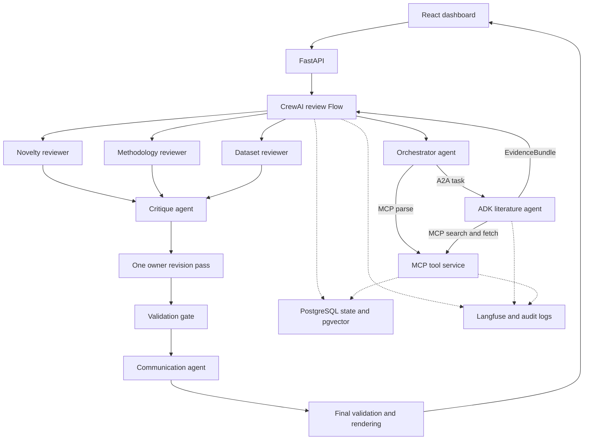
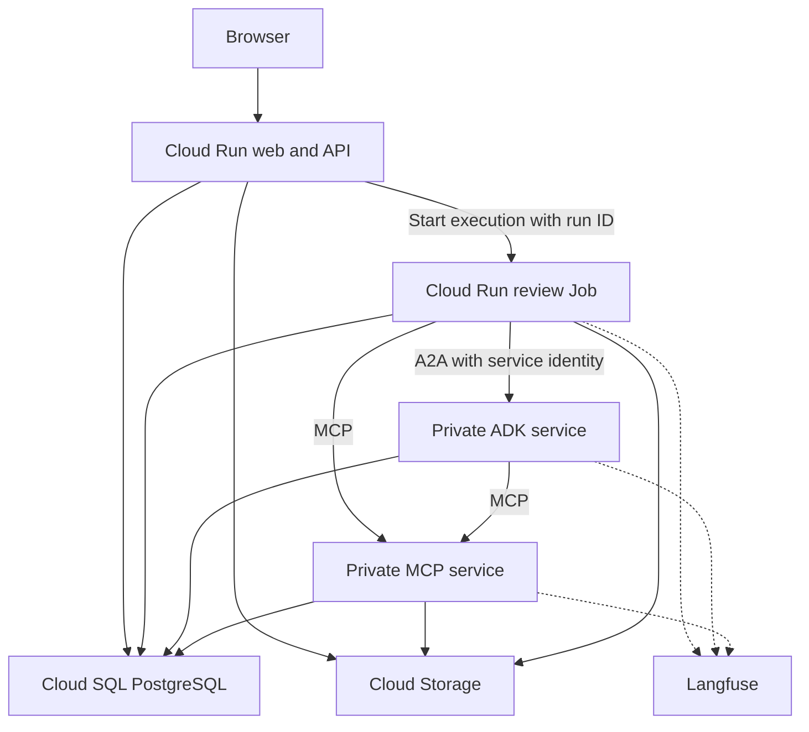

# PaperLens: implementation architecture and methodology

Prepared 21 November 2026. Status: proposed implementation specification, informed by course materials and current official documentation. No application has been implemented, benchmarked, or deployed as part of this architecture review. All performance targets and cost scenarios below are estimates or acceptance goals, not experimental results.

## 1. Decision and scope

Build PaperLens as an evidence-grounded academic paper reviewer. Use **CrewAI Flow for application orchestration and specialist review**, and a **separate Google ADK literature-retrieval agent exposed through A2A**. Connect both frameworks to an authenticated MCP tool service. Persist validated run state in PostgreSQL, keep evidence embeddings in pgvector, and trace the complete execution in Langfuse. Deploy containerized components on Google Cloud Run, with the review workflow executed as a Cloud Run Job.

This preserves the seven roles and single challenge/revision round in the submitted synopsis while correcting its compliance gaps. The goal is an explainable first-pass research review with verifiable evidence, not automated publication acceptance or proof that a research idea is globally novel.

### Core release

- English, machine-readable PDFs or pasted paper text; start with empirical CS/AI papers.
- One submission per review, initially up to 20 MB and 30 pages. These are proposed application limits.
- Related-literature retrieval, novelty comparison, methodology analysis, dataset/evidence analysis, one critique round, structured report and exports.
- Every factual finding points to the submission or retrieved evidence; unsupported findings are visibly marked unverified.
- Full state history, callbacks, A2A exchanges, MCP calls, guardrail outcomes, traces, performance measurements and cloud demo.

### Extension after core acceptance

Problem-Assessment Mode uses an explicitly selected mode and a proposal-specific rubric. Reuse retrieval, novelty and feasibility agents. Assess proposed data access, baselines and validation plans; mark actual experimental evidence as not applicable. Do not invent experiments for a proposal.

OCR, broad multidisciplinary reviewing, executing submitted code, autonomous crawling, fine-tuning, unlimited debate, and local GPU inference are outside the core. GROBID/OCR can be evaluated later if parsing failures justify their operational cost. A text-only system must report figures or tables it could not assess.

## 2. Grounding in your materials

The review covered extracted content from 1.pdf through 7.pdf, the complete handout and report template, selected visual pages, the six-page PaperLens synopsis, the repository README/tree and relevant teaching examples. Source PDFs with image-only instructional slides were not transcribed exhaustively. Repository inspection was selective, not execution of every notebook.

| Material | Relevant course content | PaperLens application |
|---|---|---|
| 1.pdf | Intelligent agents, PEAS, state, embeddings | Define measurable performance, bounded actions and searchable evidence |
| 2.pdf | LLM agents, tools, planning and memory | Separate language reasoning from deterministic processing |
| 3.pdf | Reflection, planning, tool use, ReAct, RAG | Retrieval planning, evidence-grounded review and bounded critique |
| 4.pdf | CrewAI agents/tasks/crews/flows, state, callbacks, observability | Flow-controlled review pipeline with typed intermediate artifacts |
| 5.pdf | Chaining, routing, parallelization, orchestrator-workers, evaluator-optimizer | Fixed outer workflow, adaptive search, independent reviewers and one revision |
| 6.pdf | ADK agents, runner, sessions/state, callbacks, MCP, A2A | Separate ADK retrieval service with real protocol exchanges |
| 7.pdf | Trajectory and response evaluation, judge bias, deployment | Human-labelled evaluation, ablations, runtime/cost evidence, Cloud Run |
| Course handout | Working application, public GitHub repository, rotating team roles, viva | Deliver runnable deployment and cross-component contribution evidence |
| Report template | Architecture/MCP/A2A/deployment diagrams, results, contribution matrix | Collect actual traces, diagrams and measurements during implementation |
| PaperLens synopsis | Seven roles, literature grounding, 10-15 papers, one critique round | Retain scientific objective and bounded review process |

### Changes required from the synopsis

| Synopsis choice | Updated design | Reason |
|---|---|---|
| CrewAI as the only named agent framework | CrewAI + ADK | Both are mandatory |
| MCP treated as an advanced extension | MCP parsing and literature search in the core | Requirement 2 |
| No explicit cross-framework protocol boundary | CrewAI Orchestrator delegates to ADK over A2A | Requirements 6 and 7 |
| Optional tracing / LangSmith | Mandatory Langfuse + correlated application logs | Clear fit with the lectures and requirement 9 |
| Citation by paper ID | Source ID + passage locator + supporting excerpt + support status | Existence of a paper does not establish support for a claim |
| Redis from the start | PostgreSQL cache initially; Redis only if measurements justify it | Smaller deployable system |
| Llama via Groq | Configurable supported Groq model, initially GPT-OSS 120B | Older Llama free/developer access has changed |
| Semester-long original timeline | Dependency-ordered delivery milestones | The handout's stated semester ended 20 November; confirm the actual remaining submission window |

The handout explicitly discusses academic integrity and AI-generated code. Use this as a design aid, attribute adapted course examples, and ensure each team member can explain and modify their implementation under the instructor's rules.

## 3. Agent and service architecture



The Flow is deterministic control code within CrewAI. It is not an additional LLM agent. Seven logical agent roles run in two framework services; there is no need for seven independently deployed containers.

| Agent | Framework | Inputs | Typed output and responsibility |
|---|---|---|---|
| Orchestrator | CrewAI | User request, parsed submission, configured limits | ReviewPlan: claims, review questions, search scope and delegation request; triggers ADK through its A2A client tool |
| Literature Retrieval | ADK | RetrievalRequest containing review plan and selected submission context | EvidenceBundle: deduplicated papers, ranked passages, coverage, search provenance and errors |
| Novelty & Gap | CrewAI | Submission claims + EvidenceBundle | DimensionReview: closest work, similarities, differences, bounded novelty verdict |
| Methodology & Feasibility | CrewAI | Method sections + relevant evidence | Two DimensionReview objects: methodological rigor and reproducibility/feasibility; assumptions, controls and baselines |
| Dataset & Evidence | CrewAI | Data/experiment/result sections + relevant evidence | DimensionReview: data fit, splits, leakage risks, metrics, uncertainty and claim/result alignment |
| Limitations & Critique | CrewAI | Three independent reviews + evidence | CritiqueBatch: targeted challenges; later closes dispositions without starting another debate |
| Communication | CrewAI | Validated revised findings, critique dispositions and deterministic scores | ReviewReport: readable structured synthesis; no new factual findings |

The Orchestrator is allowed to identify paper-specific questions and retrieval priorities, but cannot remove mandatory stages, raise budgets or create extra agents. Specialist autonomy concerns what evidence to inspect and what conclusions are justified. The outer process is deliberately bounded.

### Framework boundary

CrewAI and ADK are the only agent frameworks. FastAPI, Pydantic, MCP SDK, A2A SDK, LiteLLM, sentence-transformers, SQLAlchemy, PostgreSQL, Docker, OpenTelemetry and Langfuse are supporting libraries/protocols/infrastructure. Do not introduce LangGraph, LangChain agents, AutoGen, OpenAI Agents SDK, PydanticAI or another agent orchestrator. Pydantic validation is different from PydanticAI.

## 4. End-to-end methodology

### Step 1: authenticate, validate and ingest

FastAPI authenticates the user, validates the upload and stores it under an application-generated object ID. Validate file signature and actual PDF readability, not only its extension. Reject corrupt/encrypted documents unless supported explicitly. Enforce size/page/time limits before starting model work. Assign submission_id, run_id, owner_id, content SHA-256 and configuration version.

The Orchestrator's ingestion task calls parse_document through MCP. The tool reads the authorized object ID; it does not accept arbitrary filesystem paths or remote URLs. Use pdfplumber for page text and layout-aware extraction, with pypdf as a fallback. Return numbered pages, sections, chunks, parsed tables where reliable and extraction warnings. Detect suspiciously empty pages or broken reading order. If usable text is insufficient, return needs_input and request text or a better PDF; do not silently review an empty paper.

Preserve source coordinates before summarization. Use section-aware chunks, initially about 500-800 tokens with modest overlap, adjusted to the chosen embedding model's tokenizer limit. For MiniLM, its shorter effective input limit requires smaller embedding subchunks or documented pooling across subchunks; do not silently truncate every 800-token evidence passage to the model limit. Keep parent passage IDs so citations remain readable.

### Step 2: create the review plan

The Orchestrator extracts the research question, contribution claims, domain, methods, datasets and evaluation criteria into ReviewPlan. It marks inaccessible figures/tables and absent sections. It chooses up to three focused search queries covering the task, method and closest baseline, and specifies an as-of date for novelty analysis.

For an historical published paper, compare novelty against work available by the selected assessment date. Later publications can support retrospective limitations only when explicitly labelled. The user's upload date is not automatically the paper's original novelty cutoff.

### Step 3: delegate literature work through A2A

The CrewAI Orchestrator invokes its delegate_literature tool, implemented with the official A2A client SDK. The client discovers the allowlisted ADK agent's Agent Card and sends RetrievalRequest as structured message content. The ADK service initializes its own session state, plans tool use, searches literature through MCP and returns a typed evidence artifact.

The Flow refuses to advance unless a genuine A2A result has been received and validated. A Python import of the ADK agent, an ordinary bespoke POST /retrieve call, or two disconnected demos does not establish A2A interoperability.

### Step 4: retrieve, deduplicate and ground evidence

Start with OpenAlex and arXiv, plus Semantic Scholar when an API key is available. Crossref is a metadata/DOI verification option rather than a required fourth integration. Configure provider-specific rate limits and Retry-After handling; do not reuse the outdated rate-limit estimate in the synopsis.

Search up to three queries, gather approximately 20-30 candidate records, deduplicate by DOI then arXiv ID/version and normalized title, and retain about 8-12 relevant works. Use lexical retrieval and embedding rank fusion; use cosine similarity for ranking, not as a numerical definition of novelty. Citation counts may inform discovery but are not a truth or quality score.

Obtain accessible full text for the most relevant papers, initially up to five. Prefer official open-access locations and arXiv; record unavailable text. An abstract can support a high-level topic comparison, but cannot justify detailed assertions about controls, hyperparameters or statistical significance absent from the abstract.

Store every source's provider ID, DOI/arXiv ID, title, authors, date, URL, retrieval time, content hash, full-text/abstract-only status, and passage locators. Separate the submitted paper from related work. Exclude the submission's own duplicate/preprint versions from closest-prior-work novelty evidence.

The ADK agent may reformulate queries once if coverage is inadequate, with a total search cap of six tool calls. It returns coverage warnings if retrieval remains weak. Retrieval does not recurse indefinitely. Freeze the evidence bundle before independent review and debate so all reviewers evaluate the same evidence snapshot.

### Step 5: independent specialist review

Run novelty, methodology and dataset/evidence tasks concurrently when provider quotas permit. Begin with a concurrency cap of two model calls; raise to three only after measuring rate-limit behavior. Each specialist sees the same ReviewPlan and evidence snapshot plus relevant submission sections, but does not see the other initial reviews.

Each finding includes its dimension, claim, severity, short rationale, source passages, uncertainty and recommended improvement. Use these distinctions:

- Observed in submission: supported by a page/section/table from the submitted paper.
- Supported comparison: supported by a retrieved passage and tied to the submission claim.
- Inference: an explicitly labelled reviewer conclusion derived from cited evidence.
- Unverified: insufficient evidence; cannot support a confident final score.
- Not applicable: the criterion does not fit this paper type or selected mode.

For missing ablations or missing dataset details, say 'not reported in the provided sections' rather than claiming the experiment was never performed. Where calculations are needed, use deterministic Python over verified numeric inputs. Never infer values from an unreadable table.

### Step 6: one bounded adversarial round

The critic inspects all three reviews and emits up to six prioritized challenges, at most two per reviewer. Each challenge references a finding ID, identifies the evidential or logical weakness, and specifies what would resolve it.

Each challenged owner receives its original review, the relevant challenge and the frozen evidence. It responds exactly once: defend, revise, retract or mark unresolved. Record both versions and any score change. The critic then performs a closure pass assigning accepted/rejected/unresolved dispositions; it cannot create a new challenge round. Empty challenge sets are valid: the critic must not invent faults to fill a quota.

Store round_index=1 and immutable stage results. Enforce the round limit in code. Prompt instructions alone are insufficient. JSON repair retries are tracked separately and do not restart substantive debate. A timeout produces an unresolved disposition, never an invented defence.

### Step 7: validate findings and compute scores

Deterministic validation checks schemas, IDs, quote/span existence, citation ownership, score ranges, stage order and round limits. The critic assesses whether the cited passage actually supports the interpretation. Human evaluation measures semantic support accuracy; a schema validator cannot guarantee factual truth.

Use a rubric with 1-5 scores for novelty, methodological rigor, evidence strength and reproducibility/feasibility. Define anchors before evaluation: 1 = major documented weaknesses, 3 = partially supported with material gaps, 5 = strong support within the assessed evidence. Dimension-specific anchors must explain what counts as weak/strong overlap, design, evidence or reproducibility. Null means insufficient evidence; it is not zero.

Keep individual dimensions primary. If all four dimensions are assessable, an optional summary index is 20 x (0.30 novelty + 0.30 methodology + 0.25 evidence + 0.15 reproducibility), giving a 20-100 range. Call it a rubric index, not a probability of correctness or acceptance. If a dimension is unknown, omit the aggregate. Do not quietly change weights between runs. Problem-Assessment Mode uses a separately versioned rubric and cannot be numerically compared to Paper-Critique Mode.

Recommendation labels: ready for further expert review, revision recommended, or insufficient evidence. Report unresolved objections even if most agents agree.

### Step 8: synthesize and export

The Communication Agent produces ReviewReport using only validated findings. Output contains an executive assessment, contribution summary, closest-work comparison table, dimension reviews, strengths, limitations, prioritized actions, unresolved questions, critique history, sources and execution metadata.

Validate ReviewReport again after synthesis. Reject invented finding IDs, altered quotations, omitted critical unresolved objections, or changed scores. Render JSON, Markdown and UI tables from the same validated object; PDF export can be added once the report view is stable. Rendering is deterministic and requires no extra model call. Show source excerpts when a user expands a citation.

## 5. Shared state, persistence and contracts

Use a typed ReviewState in CrewAI Flow as the logical aggregate. Persist checkpoints in PostgreSQL after successful stages. ADK maintains a separate persistent session; the two processes do not share a Python dictionary or automatically synchronize session state.

| State field | Writer | Readers |
|---|---|---|
| submission, parsed_document_ref | Ingestion result accepted by Flow | Planner and reviewers |
| review_plan | Orchestrator result accepted by Flow | ADK and specialist reviewers |
| evidence_bundle_ref, evidence_hash | Validated A2A response accepted by Flow | Reviewers and critic |
| novelty_review, methodology_review, evidence_review | Individual task results merged by Flow | Critic and finalizer |
| challenges | Critic | Relevant finding owners |
| revisions, critique_closure | Owners, then critic | Finalizer |
| final_report_ref, scores | Validated synthesis and scoring code | API and dashboard |
| stage, version, budgets, errors, trace_id | Flow/runtime callbacks | Recovery, audit and UI |

Have parallel branches return separate results. The coordinator merges them once after the join; concurrent agents must not overwrite the same aggregate JSON document. Use database transactions, optimistic version checks and stage result uniqueness constraints.

Suggested tables: submissions; review_runs; run_checkpoints; documents; document_chunks with pgvector; run_sources; findings and finding_versions; challenges; responses; reports; audit_events; provider_cache; a2a_tasks. ADK session tables live in a separate namespace managed by its session service. Scope all user data by owner and run. Enable ownership filtering in both application queries and database access policies where feasible.

Each stage result is keyed by run_id, stage_name, input_hash and configuration_version. A retry can reuse a completed stage only if these match. A database lease with heartbeat prevents duplicate workers for one run. Resume at stage boundaries; do not claim checkpointing can resume halfway through a provider's model generation.

### Contract sketch

```python
from typing import Literal
from pydantic import BaseModel, ConfigDict, Field, model_validator

class EvidenceRef(BaseModel):
    model_config = ConfigDict(extra='forbid')
    source_id: str
    chunk_id: str
    locator: str
    quote: str
    source_kind: Literal['submission', 'literature']

class Finding(BaseModel):
    model_config = ConfigDict(extra='forbid')
    finding_id: str
    dimension: Literal['novelty', 'methodology', 'evidence', 'reproducibility']
    claim: str
    rationale: str
    status: Literal['supported', 'inference', 'unverified']
    evidence: list[EvidenceRef] = Field(default_factory=list)
    severity: Literal['info', 'minor', 'major']
    suggested_action: str

    @model_validator(mode='after')
    def require_evidence(self):
        if self.status in {'supported', 'inference'} and not self.evidence:
            raise ValueError('Supported findings and inferences require evidence')
        return self

class DimensionReview(BaseModel):
    dimension: Literal['novelty', 'methodology', 'evidence', 'reproducibility']
    score: int | None = Field(default=None, ge=1, le=5)
    assessability: Literal['assessed', 'insufficient_evidence', 'not_applicable']
    findings: list[Finding]
    uncertainty: str

class ReviewState(BaseModel):
    run_id: str
    state_version: int = 0
    stage: str = 'queued'
    evidence_bundle_ref: str | None = None
    reviews: dict[str, DimensionReview] = Field(default_factory=dict)
    critique_round: int = Field(default=0, ge=0, le=1)
    errors: list[str] = Field(default_factory=list)
```

This is a design sketch, not a full implementation. Add versioned ReviewPlan, RetrievalRequest, EvidenceBundle, CritiqueBatch, RevisionResponse and ReviewReport models. Each specialist returns an AgentReviewBundle containing its assigned DimensionReview objects: novelty owns novelty, methodology owns methodology and reproducibility, and dataset/evidence owns evidence. The coordinator flattens these into the state reviews dictionary by dimension. The full validators must enforce dimension uniqueness, score/assessability consistency, existing source/chunk IDs and exact authorized source spans using server-side lookup. A nonempty evidence list alone does not prove grounding. Use Pydantic v2 validation at API, MCP, A2A, task-output and publication boundaries.

## 6. MCP tool design

Deploy one small MCP service with narrowly scoped capabilities. Two tools meet the minimum; several focused functions make evidence handling practical without adding more agents.

| Tool | Backing implementation | Consumer | Return |
|---|---|---|---|
| parse_document | pdfplumber/pypdf + authorized object store | CrewAI Orchestrator | ParsedDocument with pages/chunks/warnings |
| search_literature | OpenAlex/arXiv, optional S2 | ADK retrieval agent | Ranked candidate metadata and provider errors |
| fetch_paper_evidence | Allowlisted open-access fetch + parser | ADK retrieval agent | Full-text/abstract passages and access status |
| lookup_paper_metadata | Provider ID/DOI lookup | ADK retrieval agent | Verified identifiers and publication metadata |
| search_evidence | PostgreSQL full-text + pgvector | ADK or authorized reviewers | Bounded passages with IDs and locators |

Minimum demo must visibly include parse_document and search_literature as actual MCP calls. A custom Python function called directly is not evidence of MCP use. The server-side implementation may use ordinary libraries and HTTP clients; the agent-facing invocation must use MCP.

Use Streamable HTTP in cloud deployments. Stdio is convenient locally, but test the deployed transport before the final demo. Use the official MCP Python SDK supported by the pinned release; the teaching demo's MCPServer import should not be copied without checking the installed API. Restrict discovered tool names on the client, validate tool schemas, cap result bytes and validate return objects before an agent consumes them.

Tool errors are typed results, distinguishing timeout, quota, unavailable source, invalid input and internal failure. Empty search results and provider failure are different states. Cache by provider, normalized query, filters and relevant configuration; preserve fetched_at and original provenance. Public literature metadata can be shared, but private submission content and review outputs cannot enter a cross-user cache.

## 7. Real A2A interoperability

Expose the ADK retrieval agent using ADK's documented A2A support, such as to_a2a where compatible with the selected release. CrewAI uses a thin BaseTool adapter around the official A2A client. That adapter handles protocol details; it does not implement a second retrieval agent.

| Boundary item | Required content |
|---|---|
| Agent Card | Retrieval skill ID, supported transport/version, authentication and input/output modes |
| Request payload | schema_version, run_id, request_id, mode, claims, queries, selected text or authorized artifact reference, cutoff, limits |
| Correlation | A2A task/context/message IDs mapped to run_id and trace_id |
| Result artifact | Validated EvidenceBundle JSON or authorized immutable object reference plus hash |
| Error handling | Distinguish submitted/working/terminal protocol states, timeout, rejection and failed tasks |
| Recovery | Persistent task/result record, request idempotency and bounded retry |

Agent Card paths, wire field names and SDK models vary by protocol version; use SDK constants and serialization rather than hand-building a vaguely A2A-shaped JSON payload. Current ADK documentation discusses A2A SDK compatibility across major versions. Choose one compatible release set and lock both services after an interoperability test.

State crosses this boundary only through explicit messages/artifacts. ADK stores retrieval context in its session, then returns EvidenceBundle. The CrewAI receiver validates it and writes the next ReviewState version. A remote state_delta is not a trusted mutation of local state.

Start with a bounded request/response operation. If asynchronous A2A tasks are used, persist the task store and poll the returned task ID through the SDK. Do not rely on an in-memory task store across Cloud Run restarts. Cancellation must propagate or expire through deadlines; late results cannot modify a cancelled run.

## 8. Guardrails, callbacks and observability

### Security and validation

| Boundary | Required safeguard |
|---|---|
| User request | Length/type checks; contextual handling of abusive instructions; prompt-injection screening |
| PDF ingestion | Size/page/time limits, parser isolation, no PDF JavaScript execution, no arbitrary local paths |
| Retrieved content | Treat all text as untrusted evidence, never as system/tool instructions |
| Tool execution | Allowlisted functions and hosts, authenticated calls, input/result schemas, timeouts |
| HTTP fetching | Revalidate every redirect; block localhost, private/link-local addresses and cloud metadata targets |
| A2A | Trusted Agent Card URL and service identity, schema/version checks and payload limits |
| Findings/report | Source/span validation, support status, score constraints, sanitized Markdown/HTML |
| Data/logs | Owner scoping, secret redaction, selective prompt capture and retention limits |
| Resource use | Run quotas, global call/token limits and bounded retries |

Prompt-injection detection is a heuristic layer, not a guarantee. The important boundary is that document instructions cannot grant tool access or override the fixed workflow. Toxic words quoted inside research data must not automatically block an otherwise legitimate review. Return actionable validation errors and record reasons.

Use custom function-based CrewAI task guardrails and ADK callbacks. The course's Demo17 illustrates a specific hallucination guardrail and notes an enterprise dependency; the project need not depend on that specialized feature. Ordinary documented task guardrails plus application validators are sufficient to implement the required safeguards.

### Callbacks

CrewAI task callbacks persist validated outputs and timing; step callbacks and event listeners capture model/tool activity and failures. Task guardrails gate invalid output before downstream use. ADK before/after-agent, before/after-model and before/after-tool callbacks validate allowed actions, record events, capture usage and update retrieval-session state through supported context APIs. Catch exceptions at execution boundaries as well, since an after callback alone is not comprehensive error handling.

Common event record: timestamp, run_id, stage, agent_name, framework, event_type, span_id, parent_span_id, input/output hashes, artifact references, tool_name, model_id, attempt, duration_ms, token counts, estimated cost, validation outcome and sanitized error code.

Callbacks are not a substitute for Langfuse tracing. Record a root review_run trace with nested stage, task, LLM, MCP and A2A spans. Propagate W3C trace context across HTTP and explicitly link async job and A2A execution spans. Merely attaching the same run_id to separate traces does not create a distributed parent/child trace.

Use one instrumentation path per framework to avoid duplicate spans, with manual protocol spans where needed. Start from current Langfuse/OpenInference integrations for CrewAI and ADK. Log concise rationales, evidence and observable actions; do not depend on hidden model chain-of-thought. Maintain an append-only application audit trail even if telemetry export is temporarily unavailable.

### Provenance path

Every published finding should resolve through: report finding ID -> accepted/revised finding version -> owning task and prompt version -> evidence chunk -> source document version/hash -> retrieval query/provider/time. Also store model ID, generation settings, framework lockfile hash and Git commit SHA. Reproducibility means replayable inputs/configuration and explainable variation, not guaranteed identical LLM text.

## 9. Deployment and application design



### Concrete deployment units

- Web/API service: FastAPI serves the compiled React/Tailwind assets and authenticated endpoints. It returns a run ID promptly and starts the job; it does not keep the review in an ephemeral BackgroundTasks thread.
- Review Job: one task per run, CrewAI Flow and specialist agents. Initial allocation 1 vCPU/2 GiB; increase only if measured. Task deadline 15 minutes, application execution budget 10 minutes, one platform retry with checkpoint reuse.
- ADK service: private authenticated A2A endpoint, persistent sessions/task results, bounded retrieval timeout initially 180 seconds. Initial allocation 1 vCPU/1-2 GiB.
- MCP service: private tool endpoint, parser and embedding dependencies. Initial allocation 1 vCPU/2 GiB; bake the embedding model into the image or preload it reliably instead of downloading on every request.
- Cloud SQL PostgreSQL with pgvector: run state, evidence metadata, vectors, audit records, sessions and cache. Use a small non-HA development instance; this is a prototype availability tradeoff.
- Cloud Storage: private original PDFs, evidence snapshots and exported reports. Apply a configurable retention policy.
- Secret Manager: provider credentials and telemetry keys; service accounts get only required access.
- Langfuse Cloud initially: avoids hosting its full infrastructure during a student prototype. Self-hosting is an optional operational choice, not a core feature.

Cloud Run services can scale to zero; Cloud SQL has its own billing lifecycle. Set service max instances, small DB connection pools and application admission limits. Cap concurrent review jobs in database-backed admission logic because service max-instance limits do not by themselves cap separately launched jobs. Pick one region and record it in the deployment manifest.

Use separate Python environments/container lockfiles for CrewAI, ADK and MCP to reduce dependency conflicts. Pin exact versions only after a working MCP+A2A+Pydantic+tracing spike. The repository's older deployment pin and newer agent examples should not be combined blindly.

### API contract

| Endpoint | Behavior |
|---|---|
| POST /submissions | Authorized PDF/text upload; returns submission_id |
| POST /reviews | Validates mode/limits, creates run and starts a job; accepts idempotency key |
| GET /reviews/{id} | Returns stage, progress, warnings and report availability |
| GET /reviews/{id}/events | Returns authorized audit events; polling first, SSE optional |
| GET /reviews/{id}/report | Returns the validated report object |
| GET /reviews/{id}/export | Produces Markdown/JSON; PDF optional |
| POST /reviews/{id}/cancel | Marks cancellation and requests execution cancellation |

Persist dispatch_pending before calling the cloud Jobs API. If dispatch fails, expose a retryable state and retry with the same run ID. If dispatch succeeds but the response is lost, duplicate launches are harmless because the job must acquire the run lease before starting. On subsequent status checks, reconcile pending launches and stale worker heartbeats; never leave a permanently running badge after a dead worker.

Dashboard views: submission and mode; pipeline progress; structured review with citations; literature comparison; challenge/revision history; execution time/cost; report downloads. Preserve a clear insufficient-evidence state. The public demo must have application authentication or tightly rate-limited demo access; a public GitHub repository does not require public access to user documents or internal services.

## 10. Performance evaluation

### Dataset and reference labels

Use 15 open-access empirical CS/AI papers: five development cases and ten held-out cases. If only ten can be labelled well, use four development and six held-out and explicitly state the smaller sample. Labels cover documented limitations, baseline/method overlap, dataset/evidence concerns and source passages. Select papers with varied study quality so the benchmark does not reward generating criticism on every input.

Two team members label each paper independently before seeing system output; a third resolves disagreements. Document the rubric and agreement. A statement absent from the initial label set is not automatically false: adjudicate additional plausible findings against sources. Protect labels and known follow-up critiques from accidental inclusion in the assessed retrieval corpus. Keep development and held-out papers separate during prompt tuning.

For novelty, use earlier work at the chosen cutoff. For retrospective limitation labels, later work may establish reference truth but must be identified as such. Do not let hindsight silently change the task.

### Experimental conditions

| Condition | Purpose |
|---|---|
| B0: single CrewAI reviewer, submission only | Establish ungrounded single-pass baseline |
| B1: single CrewAI reviewer with frozen retrieved evidence | Isolate benefit of retrieval |
| B2: three specialists with evidence, no critique | Isolate specialization |
| B3: full PaperLens, one critique/revision round | Measure incremental critique value |

Use the same base model, rubric and output schema. B1-B3 consume the same evidence snapshot for the quality comparison. Report their different token/call budgets rather than hiding extra compute. Run ten held-out papers x four conditions x three repeats = 120 review runs; test live retrieval and cloud latency separately to include their overhead. Never report frozen-retrieval benchmark latency as full live end-to-end latency.

### Metrics

| Metric | Definition / collection |
|---|---|
| Limitation precision | Human-confirmed valid flagged limitations / all adjudicated flagged limitations |
| Limitation recall | Matched labelled limitations / all eligible labelled limitations; report matching rules |
| F1 | Harmonic mean of precision and recall, with zero-denominator handling |
| Citation validity | References resolving to the stored source/span / all references |
| Citation support | Adjudicated factual claims actually supported / adjudicated factual claims labelled supported |
| Unsupported assertion rate | Unsupported factual assertions presented confidently / factual assertions assessed |
| Retrieval recall@10 | Known relevant sources found in top ten / known eligible relevant sources |
| Novelty agreement | Human rubric agreement and score difference; ordinal agreement where sample permits |
| Critique benefit | Paired B3 minus B2 quality; errors corrected minus new errors introduced |
| Operational success | Completed schema-valid reports / all attempted supported inputs |
| Trajectory compliance | Required MCP calls, A2A exchange, stage dependencies, one critique round |
| Runtime | Submission-to-report wall time, queue/startup time and per-stage times; median/p95 |
| Cost | All provider tokens/calls including retries, cloud execution and allocated infrastructure |

Report per-paper results, counts and uncertainty, not only an aggregate percentage. Three repeats measure stochastic variability; they do not triple the number of independent papers. If calculating confidence intervals, resample at the paper level. With this small dataset, p95 is descriptive and unstable. LLM-as-a-judge can be secondary, with order-swapped pairwise comparisons and human spot checks; it is not ground truth.

### Proposed release targets

100% final schema compliance and source-ID resolution for published reports; 100% correct one-round and cross-owner access behavior on the test suite; at least 90% end-to-end success on supported test inputs. Aim for at least 90% human-checked support among claims labelled supported and a positive B3-vs-B2 improvement, but report actual outcomes even if targets are missed. Do not assume critique necessarily improves quality.

Security/reliability test cases: injection inside a PDF, abusive instructions versus quoted research text, malformed MCP result, fake citation, invalid A2A schema, unauthorized run/source access, oversized/corrupt PDF, abstract-only literature, provider 429/timeout, one failed reviewer, duplicate job dispatch, worker restart, cancellation, telemetry outage and unavailable figures/tables.

## 11. Runtime and cost estimates

### Work limits and latency

Initial limits: 6 search calls, 30 candidate records, 12 retained papers, 5 external full texts, 6 critique challenges, one response per challenged owner, maximum two simultaneous model requests, one format-repair retry per failed stage, two transport retries for transient provider calls, and a global cap of 35 model calls. Enforce global limits across nested framework/tool retries. Record effective counts, not just configured limits.

| Stage | Planning range, not measured |
|---|---|
| Parse and plan | 10-35 seconds |
| Literature search/fetch/embedding | 20-120 seconds |
| Initial specialist reviews | 30-90 seconds elapsed with concurrency cap |
| Challenge, owner response and closure | 40-140 seconds |
| Final synthesis/validation/export | 15-45 seconds |

These sum to roughly 2-7 minutes before queue/cold-start/retry variation. Use 3-8 minutes as a provisional normal-run planning envelope and a 10-minute application budget, then replace it with measured warm/cold median and p95. Invalid or unsupported inputs should terminate early.

### Model choice and inference cost

Initial candidate: Groq-hosted openai/gpt-oss-120b across agents; configure through CrewAI's model integration and ADK's documented LiteLLM adapter. LiteLLM is used only as a model connector. Validate tool calling, structured output and usage accounting before committing to the model. Keep provider/model in configuration. This model choice updates the older Llama assumption without requiring local GPU inference.

At the official Groq model listing accessed 21 November 2026, GPT-OSS 120B is listed at USD 0.15 per million input tokens and USD 0.60 per million output tokens. Pricing and account availability must be rechecked at implementation. Use all billed output tokens, including reasoning tokens where billed, rather than only visible report text.

Example per review with 40,000 input and 30,000 billed output tokens:

`LLM cost = 40,000/1,000,000 x 0.15 + 30,000/1,000,000 x 0.60 = USD 0.024`

A scenario of 40k-80k input and 15k-35k billed output gives approximately USD 0.015-0.033 before retries. A 2x allowance gives USD 0.03-0.066. These token volumes are assumptions to be tested. Free-tier availability changes the cash charge, not the economic token accounting.

### Cloud and total cost

Use `sum(vCPU-seconds x regional CPU rate + GiB-seconds x regional memory rate)` for compute, plus request charges where applicable. For illustration, a 300-second review job at 1 vCPU/2 GiB using a USD 0.000018/vCPU-second and USD 0.000002/GiB-second price row costs about USD 0.0066 before free-tier credits. Add ADK/MCP/API services separately; the job figure is not the full system cost.

Cloud SQL is an idle as well as active cost. As a reference scenario, the retrieved shared-core table lists db-g1-small at USD 0.035/hour: 730 hours would be USD 25.55 before disk, backups, networking, taxes or regional differences. Verify the region and actual provisioned SKU. db-f1-micro is smaller but offers little memory; do not pick it merely to make a cost estimate look lower.

For an initial planning budget, reserve USD 35-60 for a month with a small database and modest demo traffic, excluding unusually high provider/API usage. This is a budget envelope, not a quote or guaranteed cap. Set billing alerts and application quotas; alerts alone do not stop spend. At only 100 reviews/month, USD 25.55 of database compute allocates about USD 0.256 per review, already exceeding the example model charge.

For the 120-run evaluation, using the full-run example for every condition would be USD 2.88 of inference before repeats caused by failures; B0-B2 should generally cost less but must be measured. Budget USD 5-15 for model development/evaluation as a provisional allowance, and add live retrieval/API charges, cloud costs, storage and tracing. Record both marginal run cost and fully allocated cost.

## 12. Build order and acceptance gates

Estimates below are person-days of focused work, not a promise about calendar completion. With three students and overlap, a realistic fresh implementation is several weeks; existing code may reduce that. Do not reuse the synopsis's elapsed September/October dates as future milestones.

| Milestone | Work | Exit evidence | Effort |
|---|---|---|---|
| M0: interoperability spike | Two containers, one CrewAI agent, one ADK agent, official A2A exchange, two MCP tools, typed result and trace | One saved trace and contract test proving the boundary works | 2-3 person-days |
| M1: ingestion and evidence | Parser, source IDs, provider adapters, cache, ranking, pgvector and provenance | A paper resolves to usable source passages, including an abstract-only case | 3-5 |
| M2: core reviews | Three specialists, Flow state, validators and JSON/Markdown renderer | End-to-end review with valid citations and checkpoints | 3-5 |
| M3: critique and recovery | One challenge round, revisions, closure, retries and cancellation | Before/after findings plus fault-injection evidence | 3-4 |
| M4: cloud and UI | React dashboard, job dispatch, service identities, storage and private internal services | Live cloud run from upload to export and trace | 3-5 |
| M5: evaluation and report | Labels, ablations, repeated runs, timings/costs and report exhibits | Reproducible evaluation package and actual results | 4-6 |
| M6: problem-assessment extension | Separate mode/schema/rubric and feasibility tests | Three proposal cases with honest not-applicable evidence fields | 2-3 |

Build the labelled development set during M1 and the held-out reference set before M5. Maintain callbacks and security boundaries from M0 rather than adding them at the end. If time is constrained, reduce provider count, corpus size and UI polish; preserve both frameworks, MCP, A2A, validation, critique, evaluation and deployment.

Recommended source modules: `apps/api`, `apps/web`, `services/review_worker`, `services/literature_adk`, `services/mcp_tools`, `contracts`, `storage`, `observability`, `security`, `evaluation`, `tests`, `infra`, and `docs`. Keep prompts, rubrics, schemas and dependency lockfiles versioned. Do not commit .env files, uploaded private papers or credentials to the required public repository.

### Team responsibilities with rotation

| Member from synopsis | Initial lead | Required cross-component work |
|---|---|---|
| Mohammad Yakub | CrewAI Flow, state, backend and A2A client | Review retrieval/guardrail code; implement one evaluator; explain all MCP tools |
| Himanshi Chaturvedi | ADK retrieval, MCP providers and evidence ranking | Implement a workflow recovery test and observability propagation; review scoring |
| Ananya Pandey | Reviewers, critic, evidence UI | Implement citation validators and cloud integration tests; explain A2A lifecycle |

Rotate reviewers/implementers at each milestone. Each student should implement and test at least one core agent feature and one protocol/state/security feature. Maintain PRs, issue links, test ownership and a short explanation log. Documentation or frontend-only contributions do not satisfy the handout's stated team expectations.

## 13. Requirement-to-evidence matrix

| # | Requirement | Design implementation | Proof to show in demo/report |
|---|---|---|---|
| 1 | Context/state updates | Typed Flow state, persistent checkpoints, explicit ADK request/result serialization | EvidenceBundle becomes reviewer input; state version before/after |
| 2 | At least two tools via MCP | parse_document + search_literature, with optional evidence tools | MCP discovery and calls with validated results |
| 3 | Pydantic structured output | Typed task outputs and ReviewReport; deterministic rendering | JSON schema, valid report and intentionally rejected malformed output |
| 4 | Suitable patterns | Planning, tool use/agentic retrieval, fan-out/join, bounded evaluator-optimizer | Annotated workflow and execution trace |
| 5 | Callback monitoring | CrewAI task/step callbacks and ADK lifecycle/tool callbacks | Intermediate outputs, durations and an error event |
| 6 | A2A interoperability | CrewAI Orchestrator -> official A2A client -> ADK agent | Agent Card, protocol task/message IDs and result artifact |
| 7 | Both required frameworks only | CrewAI review service + ADK retrieval service | Source imports, architecture and per-service dependencies |
| 8 | Guardrails/security | Input/tool/output validation, prompt-injection boundaries, auth and quotas | Malformed tool, injection and cross-owner tests |
| 9 | Observability/provenance | Langfuse distributed traces + audit records + source hashes | One correlated run with source-to-finding lineage |
| 10 | E2E evaluation/time/cost | Human labels, B0-B3 experiments, live runs and usage accounting | Actual tables, paired comparisons, latency chart and cost sheet |
| 11 | Cloud deployment | Cloud Run web/API, Job, private ADK/MCP, persistent storage | Live URL, deployment diagram and cloud execution evidence |

## 14. Report and viva evidence plan

Use the supplied report template as the submission structure, not as a request to fabricate completed results. Its contents page assigns methodology about pages 7-16 and experiments about pages 18-25; follow instructor expectations for final length.

| Template section | Material to prepare |
|---|---|
| Introduction | Purpose, scope, users and explainable review objective |
| Problem Statement | Literature effort, confirmation bias, grounding and scope limitations |
| Literature Review | Properly researched existing paper-review/literature-assistant approaches and gaps; this architecture review is not a completed competitor literature review |
| Methodology | Agent graph, runtime sequence, state ownership, A2A contract, MCP tools, critique rules, validation and deployment diagram |
| Technology Stack | Actual pinned frameworks, libraries, model/provider and infrastructure |
| Experimental Results | Real output cases, ablations, human labels, security cases, failure behavior, time and cost |
| Team Matrix | Actual contributions with rotating technical roles and evidence |
| Conclusions | What results support, remaining failure modes and extension status |
| References/Appendix | Source documentation, attributed course adaptations, schemas, selected code and reproducibility instructions |

Suggested demo: upload a public paper; show MCP extraction/search; open the CrewAI-to-ADK A2A trace; show three reviewers; inspect one challenged finding and its revision; expand a cited excerpt; trigger one controlled invalid-input or tool failure; open the final report, cloud execution and measured cost. Keep a recorded genuine run as a network-failure backup and label it as recorded.

The system's distinctive contribution is not agent count. It is the combination of independent evidence-grounded dimensions, traceable cross-framework collaboration, and a bounded critique step whose benefit is tested against a no-critique baseline.

## 15. Implementation references and course-code map

Repository inspected at tree commit `424d3795fda803aa783d6868b22bddd84a26fcc9`. It is teaching material, not a tested application dependency. Reuse concepts with attribution and verify APIs against the pinned runtime.

| Teaching example | Reuse |
|---|---|
| CrewAI_Demo3 | Pydantic task outputs and context passing |
| CrewAI_Demo6 | Usage metrics and tool failure inspection |
| CrewAI_Demo10 | Task and step callbacks |
| CrewAI_Demo12 | Typed Flow state and event dependencies |
| CrewAI_Demo14 | Langfuse observability concepts |
| CrewAI_Demo17 | Guardrail motivation; avoid requiring its specialized enterprise example |
| ADK/session_runner_demo/session_with_state_update | Persistent session/state concepts; use supported context APIs |
| ADK/callback_demo/simple_callback_demo | Tool callback placement; replace debug access to private fields with supported APIs |
| ADK/mcp_demo | Client discovery and agent-to-tool protocol separation |
| ADK/A2A/a2a_fact_checker | Exposing/consuming agents; replace one side with CrewAI client integration |
| ADK/Eval | Trajectory and response evaluation ideas; adapt metrics to paper review |
| ADK/Deployment | Cloud Run packaging concepts; update pins and keep internal services authenticated |

Primary technical references checked for this specification:

1. [Course repository](https://github.com/soharabhossain/Agentic_AI)
2. [CrewAI Tasks: Pydantic outputs and function guardrails](https://docs.crewai.com/en/concepts/tasks)
3. [CrewAI Flows](https://docs.crewai.com/en/concepts/flows)
4. [CrewAI MCP integration](https://docs.crewai.com/en/mcp/overview)
5. [ADK A2A exposure](https://adk.dev/a2a/quickstart-exposing/)
6. [A2A protocol specification](https://a2a-protocol.org/latest/specification/)
7. [Official MCP server guide](https://modelcontextprotocol.io/docs/develop/build-server)
8. [ADK LiteLLM model connector](https://adk.dev/agents/models/litellm/)
9. [Langfuse CrewAI integration](https://langfuse.com/integrations/frameworks/crewai)
10. [ADK Langfuse integration](https://adk.dev/integrations/langfuse/)
11. [Groq model availability and pricing](https://console.groq.com/docs/models)
12. [Groq deprecations](https://console.groq.com/docs/deprecations)
13. [OpenAlex authentication and limits](https://help.openalex.org/api/authentication/)
14. [Semantic Scholar API](https://webflow.semanticscholar.org/product/api)
15. [arXiv API manual](https://github.com/arXiv/arxiv-docs/blob/develop/source/help/api/user-manual.md)
16. [Cloud Run Jobs](https://docs.cloud.google.com/run/docs/create-jobs)
17. [Cloud SQL pgvector](https://docs.cloud.google.com/sql/docs/postgres/generate-manage-vector-embeddings)
18. [Cloud Run pricing](https://cloud.google.com/run/pricing)
19. [Cloud SQL pricing](https://cloud.google.com/sql/pricing)

Project source: [PaperLens synopsis](https://chatgpt.com/library?file_id=libfile_136059057e9c81918ae3e182c7979b20&account_id=personal). Local course sources: `1.pdf`-`7.pdf`, `Course_Handout__Agentic AI.pdf`, `Final_Project_Report_Template.pdf` in the supplied project folder.
