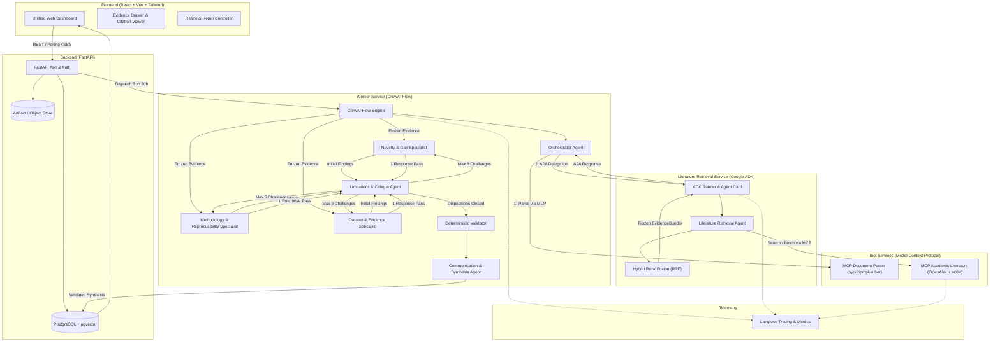

# PaperLens: Master Implementation & Execution Plan

**Document Version:** 1.0 (Final Unified Specification)  
**Date:** 21 November 2026  
**Status:** Authoritative Execution Contract  
**Primary Objective:** Deliver a fully functional, evidence-grounded academic research review and idea exploration platform (**PaperLens**) deployed on Google Cloud Run, backed by PostgreSQL/pgvector, with verified CrewAI + Google ADK + MCP + A2A inter-agent architecture and Langfuse distributed tracing.

---

## 1. Executive Summary & Core Requirements

PaperLens is an agentic AI system designed to rigorously evaluate scientific research papers and assist in scoping novel research ideas. It replaces superficial peer-review automation with verifiable, evidence-grounded scientific critique.

### 1.1 Dual-Mode Release Mandate
Both operational workflows must be available in the **same authenticated deployment** sharing a unified dashboard, evidence viewer, and run history:

1. **Paper-Critique Mode (Mode A):**
   * **Input:** Machine-readable English empirical CS/AI paper (PDF up to 20 MB / 30 pages, or pasted text up to 150,000 characters).
   * **Process:** Ingestion with exact locators, live academic literature retrieval via ADK, three independent specialist analyses, one bounded critique and response round, and deterministic citation verification.
   * **Output:** A cited evaluation assessing the alignment between research question, methodology, datasets, empirical claims, reproducibility, closest prior work, and prioritized actionable revisions.
2. **Research Idea Exploration Mode (Mode B):**
   * **Input:** A rough research hypothesis, question, or proposed method; optional declared constraints (available compute, timeline, dataset access).
   * **Process:** Problem formulation refinement, surfacing unstated assumptions, retrieval of closest baseline work and candidate research gaps, and feasibility analysis.
   * **Output:** A cited research brief with baseline methods, evaluation metrics, smallest viable preliminary study, and a **Refine & Rerun** workflow that branches new linked runs without overwriting history.

### 1.2 Mandatory Architectural & Course Invariants
1. **Framework Separation:** Orchestration and review specialists run in **CrewAI** (Flow-based execution); literature retrieval runs in an independent **Google ADK** agent service.
2. **Protocol Boundary:** The CrewAI Orchestrator delegates retrieval tasks to the ADK service via the official **Agent-to-Agent (A2A)** protocol over HTTP with typed request/response artifacts.
3. **Tool Isolation:** Real document extraction and literature searches are exposed via authenticated **Model Context Protocol (MCP)** tool servers.
4. **Persistent State:** PostgreSQL with `pgvector` for durable run state, immutable artifact snapshots, passage embeddings, and hybrid lexical/vector search.
5. **Bounded Single-Round Critique:** Critic agent issues up to 6 challenges (max 2 per specialist). Each challenged owner responds once. A closure pass resolves dispositions (accepted, revised, unresolved). **A hard code guard prevents a second debate round.**
6. **Grounding & Verifiability:** Every factual claim must link to an exact passage locator (`source_id`, page/paragraph, text span). Inferences and missing data must be labeled explicitly as unassessable or candidate gaps.
7. **Full Observability:** Correlated **Langfuse** distributed traces linking web requests, worker stages, A2A exchanges, MCP tool calls, and model token usage.

---

## 2. System Architecture & Inter-Agent Workflows



### 2.1 The Seven Logical Roles

| # | Role Name | Host Framework | Input Contract | Output Contract | Guardrails & Restrictions |
|---|---|---|---|---|---|
| **1** | **Orchestrator** | CrewAI | Submission / User Context | `ReviewPlan`, Parsed Paper | Cannot modify evaluation rubrics or bypass validation gates. |
| **2** | **Literature Retrieval** | Google ADK | Search Topics, Cutoff, Keywords | `EvidenceBundle` | At most one reformulation cycle; max 12 works; max 5 full texts; bounded by provider rates. |
| **3** | **Novelty & Gap Specialist** | CrewAI | Submission + `EvidenceBundle` | `NoveltyReview` | Excludes submission preprint versions from prior art; similarity != novelty score. |
| **4** | **Methodology Specialist** | CrewAI | Submission + `EvidenceBundle` | `MethodologyReview` | Distinguishes declared experimental setup from unverified assertions; evaluates baselines and leakage. |
| **5** | **Dataset & Evidence Specialist** | CrewAI | Submission + `EvidenceBundle` | `EvidenceReview` | Flags unverified data splits, missing statistical significance, and metric inconsistencies. |
| **6** | **Limitations & Critique** | CrewAI | Specialist Findings | `CritiqueBatch`, `CritiqueClosure` | Max 6 challenges (max 2 per specialist); strictly one response pass; closure only assigns dispositions. |
| **7** | **Communication & Synthesis** | CrewAI | Validated Findings & Dispositions | `ReportDraft` | Cannot introduce new literature or citations; preserves unresolved disputes; generates structured output. |

---

## 3. Repository Directory Structure

```
paperlens/
├── apps/
│   ├── api/                           # FastAPI Application Service
│   │   ├── src/
│   │   │   ├── auth/                  # Session / Bearer authentication
│   │   │   ├── routers/               # /submissions, /runs, /reports, /exports
│   │   │   ├── services/              # Job dispatcher, storage service
│   │   │   └── main.py
│   │   ├── tests/
│   │   ├── Dockerfile
│   │   └── pyproject.toml
│   └── web/                           # React Frontend Application
│       ├── src/
│       │   ├── components/            # EvidenceDrawer, ReportView, CritiqueTimeline, IdeaForm
│       │   ├── hooks/                 # useRunStatus, useReport
│       │   ├── types/                 # Generated API TypeScript types
│       │   └── App.tsx
│       ├── package.json
│       ├── vite.config.ts
│       └── Dockerfile
├── services/
│   ├── review_worker/                 # CrewAI Review Engine
│   │   ├── src/
│   │   │   ├── flow.py                # Main CrewAI Flow state machine
│   │   │   ├── roles/                 # Orchestrator, Specialists, Critic, Communicator
│   │   │   ├── a2a_client.py          # A2A client delegating to ADK
│   │   │   └── worker_main.py         # Entrypoint for Cloud Run Job / local execution
│   │   ├── tests/
│   │   ├── Dockerfile
│   │   └── pyproject.toml
│   ├── adk_retrieval/                 # Google ADK Literature Service
│   │   ├── src/
│   │   │   ├── agent.py               # ADK agent definition & prompt
│   │   │   ├── a2a_server.py          # A2A Agent Card & HTTP handler
│   │   │   ├── ranking.py             # Reciprocal Rank Fusion (RRF)
│   │   │   └── retrieval_main.py
│   │   ├── tests/
│   │   ├── Dockerfile
│   │   └── pyproject.toml
│   └── mcp_server/                    # MCP Tool Provider Service
│       ├── src/
│       │   ├── tools/
│       │   │   ├── doc_parser.py      # PDF locator-preserving extractor
│       │   │   ├── openalex.py        # OpenAlex academic API adapter
│       │   │   └── arxiv.py           # arXiv API adapter
│       │   └── mcp_main.py            # Streamable HTTP MCP server
│       ├── tests/
│       ├── Dockerfile
│       └── pyproject.toml
├── packages/
│   └── shared_contracts/              # Common Pydantic v2 Models & DB Schemas
│       ├── src/
│       │   ├── models/                # Run, EvidenceBundle, Finding, Report models
│       │   └── db/                    # SQLAlchemy models & Alembic migrations
│       └── pyproject.toml
├── docs/
│   ├── implementation_status.md       # Live tracking of acceptance gates & evidence
│   ├── decisions.md                   # Architecture Decision Records (ADRs)
│   └── compatibility.md               # Pinned SDK & protocol matrix
├── docker-compose.yml                 # Local full-stack environment
├── .env.example                       # Documented environment variables
└── README.md
```

---

## 4. Data Contracts & Database Schema

All models inherit from `pydantic.BaseModel` (v2) with strict typing.

### 4.1 Key Data Structures

```python
# 1. Run State & Mode
class RunMode(str, Enum):
    PAPER_CRITIQUE = "paper_critique"
    IDEA_EXPLORATION = "idea_exploration"

class RunStatus(str, Enum):
    QUEUED = "queued"
    INGESTING = "ingesting"
    RETRIEVING = "retrieving"
    REVIEWING = "reviewing"
    CRITIQUING = "critiquing"
    SYNTHESIZING = "synthesizing"
    COMPLETED = "completed"
    FAILED = "failed"
    CANCELLED = "cancelled"

# 2. Evidence Grounding
class SourcePassage(BaseModel):
    passage_id: str = Field(default_factory=lambda: str(uuid4()))
    source_id: str                      # DOI, arXiv ID, or "submission"
    source_title: str
    page_number: Optional[int] = None
    section_name: Optional[str] = None
    text_span: str                      # Exact verbatim quote
    access_status: str                  # "full_text", "abstract_only", "user_submission"
    url: Optional[str] = None

class EvidenceBundle(BaseModel):
    bundle_id: str = Field(default_factory=lambda: str(uuid4()))
    queries_used: List[str]
    literature_cutoff: Optional[str] = None
    retrieval_timestamp: datetime
    sources: List[SourcePassage]
    provider_errors: List[str] = []
    is_frozen: bool = True

# 3. Findings & Critique
class Finding(BaseModel):
    finding_id: str = Field(default_factory=lambda: str(uuid4()))
    creator_role: str                   # e.g., "novelty_specialist"
    dimension: str                      # "novelty", "methodology", "evidence", "feasibility"
    claim: str
    rationale: str
    confidence: float                   # 0.0 to 1.0
    evidence_refs: List[str]            # List of passage_id references
    status: str                         # "proposed", "challenged", "defended", "revised", "retracted"
    version: int = 1

class Challenge(BaseModel):
    challenge_id: str = Field(default_factory=lambda: str(uuid4()))
    target_finding_id: str
    critic_argument: str
    suggested_revision: Optional[str] = None

class Disposition(str, Enum):
    ACCEPTED = "accepted"
    REVISED = "revised"
    UNRESOLVED = "unresolved"

class CritiqueClosure(BaseModel):
    dispositions: Dict[str, Disposition] # challenge_id -> Disposition
    unresolved_notes: List[str] = []

# 4. Final Published Report
class PaperLensReport(BaseModel):
    run_id: str
    mode: RunMode
    title: str
    executive_summary: str
    dimension_assessments: Dict[str, Any]
    validated_findings: List[Finding]
    critique_history: List[Dict[str, Any]]
    unassessable_aspects: List[str] = []
    prioritized_next_actions: List[str]
    citations: List[SourcePassage]
    created_at: datetime
```

### 4.2 Database Tables (PostgreSQL 16 + pgvector)
1. `runs`: `id`, `owner_id`, `mode`, `status`, `lease_token`, `lease_expires_at`, `parent_run_id` (for refinements), `created_at`, `updated_at`.
2. `submissions`: `id`, `run_id`, `input_type` (`pdf` | `text`), `raw_text`, `storage_path`, `char_count`, `checksum`.
3. `source_passages`: `id`, `run_id`, `source_id`, `locator`, `passage_text`, `embedding` (`vector(384)`), `access_status`.
4. `evidence_bundles`: `id`, `run_id`, `bundle_json`, `is_frozen`, `created_at`.
5. `findings`: `id`, `run_id`, `version`, `creator_role`, `finding_json`, `is_final`.
6. `critique_rounds`: `id`, `run_id`, `challenges_json`, `responses_json`, `closure_json`.
7. `reports`: `id`, `run_id`, `report_json`, `markdown_export`, `created_at`.
8. `audit_events`: `id`, `run_id`, `stage`, `event_type`, `payload_sanitized`, `timestamp`.

---

## 5. Milestone-by-Milestone Execution Plan

### Milestone 0: Interoperability Foundation & Protocol Spike (M0)
**Objective:** Eliminate framework integration risk immediately by establishing real inter-process communication between CrewAI, ADK, A2A, and MCP with telemetry.

* **Tasks:**
  1. Initialize Git repository with initial `.gitignore`, `.env.example`, and directory structure.
  2. Implement `packages/shared_contracts` with Pydantic v2 data models.
  3. Spin up local PostgreSQL with `pgvector` extension via `docker-compose.yml`.
  4. Build the **MCP Tool Server** (`services/mcp_server`) exposing:
     * `parse_pdf_tool`: Extracts page text with character offsets.
     * `search_literature_tool`: Queries arXiv API with a sample query.
  5. Build the **Google ADK Service** (`services/adk_retrieval`):
     * Expose an ADK Agent Card over an HTTP server.
     * Configure the agent to handle an `AssembleEvidenceRequest` by invoking the MCP search tool.
  6. Build the **CrewAI Worker Spike** (`services/review_worker`):
     * Discover the ADK Agent Card using the official A2A client.
     * Execute an A2A delegation call and deserialize the typed `EvidenceBundle`.
     * Direct call to MCP `parse_pdf_tool`.
  7. Configure Langfuse tracing across all three processes and verify distributed trace linkage with correlated `trace_id`.
* **Exit Gate:** A reproducible PowerShell script (`scripts/test_m0_spike.ps1`) executes CrewAI ➔ A2A ➔ ADK ➔ MCP and outputs a verified Langfuse trace URL. A malformed A2A payload correctly raises a Pydantic validation error.

---

### Milestone 1: Ingestion, Evidence Engine & Hybrid Retrieval (M1)
**Objective:** Deliver accurate document parsing and reliable academic literature retrieval backed by pgvector.

* **Tasks:**
  1. **Document Ingestion:**
     * Support PDF uploads up to 20 MB / 30 pages and pasted text up to 150,000 characters.
     * Preserve exact locators (page numbers, section headings, paragraph indices).
     * Add parser fallbacks (handle low-text PDFs, encrypted files, and unreadable figures gracefully).
  2. **Academic Retrieval Adapters:**
     * Implement OpenAlex adapter (filtering by publication year cutoff and concept tags).
     * Implement arXiv API adapter with rate-limiting backoff.
     * Deduplicate sources by normalized DOI, arXiv ID family, and fuzzy title matching.
     * Filter out preprints or previous versions of the submitted paper from novelty comparisons.
  3. **Vector Embeddings & Hybrid Search:**
     * Pin embedding model (e.g., `all-MiniLM-L6-v2`, 384 dimensions).
     * Store chunked submission and retrieved passages in PostgreSQL with pgvector indexes.
     * Implement Reciprocal Rank Fusion (RRF) combining keyword/BM25 full-text search and vector cosine similarity.
  4. **ADK Evidence Freezing:**
     * Limit retrieval to at most 12 retained sources and 5 full-text extractions.
     * Freeze the `EvidenceBundle` in the database to prevent non-deterministic drift across review stages.
* **Exit Gate:** Uploading a sample arXiv paper yields indexed, searchable passages. Citation lookups retrieve the exact verbatim text and page locator. Provider timeouts degrade gracefully to partial coverage warnings without crashing.

---

### Milestone 2: Core Paper Specialist Pipeline & Report Synthesis (M2)
**Objective:** Execute the three independent specialist evaluations and generate deterministic, cited reports.

* **Tasks:**
  1. **CrewAI Flow Implementation:**
     * Define deterministic stage transitions: `ingest` ➔ `retrieve` ➔ `specialist_review` ➔ `synthesis` ➔ `publish`.
     * Store immutable stage checkpoints in PostgreSQL to allow resumption after transient failure.
  2. **Specialist Reviewers:**
     * **Novelty & Gap Specialist:** Identifies closest prior art from the `EvidenceBundle`, isolates key algorithmic differences, and pinpoints candidate gaps.
     * **Methodology & Reproducibility Specialist:** Audits baseline fairness, ablation integrity, compute disclosure, and dataset split hygiene.
     * **Dataset & Evidence Specialist:** Validates empirical claims against reported tables, checks metric calibration, and flags missing confidence intervals.
     * *Constraint:* Specialists run in isolation without visibility into peer initial findings.
  3. **Deterministic Validation Gate:**
     * Code-level validator verifies that every finding citation matches a genuine `passage_id` in the frozen `EvidenceBundle`.
     * Reject or mark findings with missing or hallucinated citations as `unverified`.
  4. **Communication & Synthesis Agent:**
     * Aggregates validated findings into an executive summary, dimension breakdowns, and prioritized recommendations.
     * Generates structured Markdown and JSON reports.
* **Exit Gate:** Running an empirical CS paper generates a complete, schema-valid review report where 100% of factual findings link to valid citation locators. Injected synthetic claims without evidence are caught and rejected by the validator.

---

### Milestone 3: Bounded Critique, Recovery & Checkpointing (M3)
**Objective:** Prevent reviewer hallucinations and dogmatism through structured critique while guaranteeing termination.

* **Tasks:**
  1. **Critic Agent Implementation:**
     * Inspects findings from all three specialists.
     * Issues up to 6 targeted challenges (max 2 per specialist) focusing on overclaimed conclusions, weak baselines, or misunderstood citations.
  2. **Owner Response & Closure Round:**
     * Challenged specialists receive their specific batch of challenges.
     * Specialists respond once: accept challenge (revise/retract finding) or defend finding with additional passage citations.
     * Critic executes a closure pass: assigns each challenge a disposition (`accepted`, `revised`, or `unresolved`).
     * **Code Guard:** Hard assertion in the Flow engine prevents any subsequent critique rounds.
  3. **Worker Leases & Crash Recovery:**
     * Database-level leasing with expiration tokens to prevent duplicate worker execution.
     * If a worker dies mid-run, a restarted worker resumes execution from the latest database checkpoint.
     * Explicit cancellation endpoints terminate active LLM chains cleanly.
* **Exit Gate:** A live run demonstrates at least one challenged finding transitioning to `revised` with preserved version history. Worker crash simulation (killing process mid-review) resumes from checkpoint and completes without duplicating stages.

---

### Milestone 4: Research Idea Exploration Mode & Refinement Loop (M4)
**Objective:** Enable the second core capability: scoping and refining unformed research ideas.

* **Tasks:**
  1. **Idea Intake & Question Refinement:**
     * Dedicated intake form for rough hypotheses, research questions, and optional constraints (timeline, budget, GPUs, private data).
     * Orchestrator generates a formalized, falsifiable research question and highlights key underlying assumptions.
  2. **Adapted Specialist Analysis:**
     * Novelty Specialist searches literature for prior attempts and candidate unaddressed niches.
     * Methodology Specialist outlines a minimal viable evaluation protocol (suggested baselines, metrics, and compute requirements).
     * Mark empirical results explicitly as `NOT_APPLICABLE` (prohibits the model from hallucinating non-existent experimental outcomes).
  3. **Refine & Rerun Loop:**
     * Dashboard provides a "Refine and Rerun" button.
     * User can adjust research questions or constraints.
     * System launches a new run linked to the parent run (`parent_run_id`), preserving comparative history.
* **Exit Gate:** Submitting an idea generates a cited research brief with a concrete first-experiment blueprint. Running "Refine and Rerun" successfully executes a secondary run with updated constraints while retaining access to the initial brief.

---

### Milestone 5: Unified Web Dashboard & Production Cloud Deployment (M5)
**Objective:** Deliver an authenticated, production-grade web application deployed on Google Cloud Platform.

* **Tasks:**
  1. **React Frontend (Vite + TypeScript + Tailwind):**
     * Clean toggle between **Review a Paper** and **Explore a Research Idea**.
     * Responsive upload forms with file validation and drag-and-drop.
     * Live stage progress indicators (polling / SSE fallback).
     * Interactive Report Viewer:
       * Executive summary & dimension scorecards.
       * Clickable citation badges opening a side **Evidence Drawer** showing the exact source excerpt, page locator, and access status.
       * Critique timeline showing original finding, challenge, and resolution.
       * One-click JSON and Markdown download.
  2. **Containerization:**
     * Multi-stage, security-hardened Dockerfiles for `apps/api`, `apps/web`, `services/review_worker`, `services/adk_retrieval`, and `services/mcp_server`.
  3. **Google Cloud Platform Deployment:**
     * **Cloud Run (Web & API):** Public authenticated frontend and backend API.
     * **Cloud Run Job:** Long-running review worker dispatched asynchronously upon submission.
     * **Cloud Run (Private Services):** ADK and MCP services protected by IAM service-to-service authentication.
     * **Cloud SQL:** Managed PostgreSQL 16 with `pgvector` accessed via Cloud SQL Auth Proxy.
     * **Google Secret Manager:** Secure storage for LLM API keys and database credentials.
* **Exit Gate:** An external user accesses the deployed Cloud Run URL, logs in, uploads a paper to receive a verified review, and subsequently tests an idea exploration workflow with refinement.

---

### Milestone 6: Scientific Evaluation, Ablation Studies & Deliverables (M6)
**Objective:** Statistically validate system performance across baselines and assemble academic deliverables.

* **Tasks:**
  1. **Evaluation Dataset:**
     * Assemble 15 public empirical CS/AI papers (5 development, 10 held-out).
     * Ground-truth annotations for key contributions, known limitations, and baseline choices.
  2. **Ablation Configurations (B0–B3):**
     * **B0 (Baseline 0):** Single reviewer, submission text only (no retrieval, no critique).
     * **B1 (Baseline 1):** Single reviewer with retrieved literature.
     * **B2 (Baseline 2):** Three independent specialists with literature (no critique).
     * **B3 (Full System):** Specialists + Bounded Critique + Deterministic Validation.
  3. **Metrics Collection:**
     * **Citation Precision:** Proportion of citations where the quoted text genuinely supports the claim.
     * **Limitation Recall:** Proportion of known paper limitations identified.
     * **Hallucination Rate:** Frequency of unsupported assertions.
     * **Latency & Cost Accounting:** Total wall-clock time and token expenditure per run.
  4. **Deliverables Package:**
     * Final project report adhering to `Final_Project_Report_Template.pdf`.
     * Public GitHub repository sanitized of secrets and personal credentials.
     * Architecture, A2A protocol, and deployment sequence diagrams.
     * Recorded demo walkthrough as a fail-safe backup.
* **Exit Gate:** Evaluation tables show quantitative improvements of B3 over B0/B1/B2. The GitHub repository passes security scans and includes a one-command local reproduction script.

---

## 6. Verification and Testing Runbook

### 6.1 Local Development Commands

```powershell
# 1. Start database infrastructure
docker-compose up -d postgres

# 2. Run database migrations
cd packages/shared_contracts
alembic upgrade head

# 3. Start MCP tool server
cd services/mcp_server
python src/mcp_main.py

# 4. Start Google ADK literature service
cd services/adk_retrieval
python src/retrieval_main.py

# 5. Start FastAPI backend
cd apps/api
uvicorn src.main:app --reload --port 8000

# 6. Start React frontend
cd apps/web
npm run dev
```

### 6.2 Test Commands

```powershell
# Unit and integration tests
pytest services/review_worker/tests -v
pytest services/adk_retrieval/tests -v
pytest services/mcp_server/tests -v

# Verification of M0 Interoperability Spike
python scripts/test_m0_spike.py

# Benchmark ablation suite
python scripts/run_ablation_benchmarks.py --baseline B3 --manifest data/manifest.json
```

---

## 7. Definition of Done (DoD) Checklist

- [ ] **Dual Workflows Operational:** Paper Critique Mode and Research Idea Exploration Mode fully functional in the same deployment.
- [ ] **Framework Integrity:** CrewAI Orchestrator and Specialists reliably coordinate with the Google ADK retrieval agent over HTTP via A2A.
- [ ] **Tool Adherence:** Document parsing and academic searches strictly execute through authenticated MCP endpoints.
- [ ] **Deterministic Evidence Grounding:** All published findings link to exact passage locators; no fabricated citations escape validation.
- [ ] **Bounded Critique Enforced:** Maximum of 6 challenges per run; strictly one owner response round; hard code guard prevents infinite loops.
- [ ] **State Durability & Resumption:** PostgreSQL stores all runs, chunks, embeddings, and findings; crashed workers cleanly resume from checkpoints.
- [ ] **Cloud Deployment Verified:** Cloud Run Web/API, Cloud Run Job worker, private ADK/MCP services, and Cloud SQL with pgvector pass live smoke tests.
- [ ] **Evaluation Completed:** Documented ablation benchmarks (B0–B3) demonstrate quantifiable gains in citation support and limitation detection.
- [ ] **Project Packaging:** Sanitized public GitHub repository, complete final report, contribution matrix, and recorded demo backup prepared for submission.
