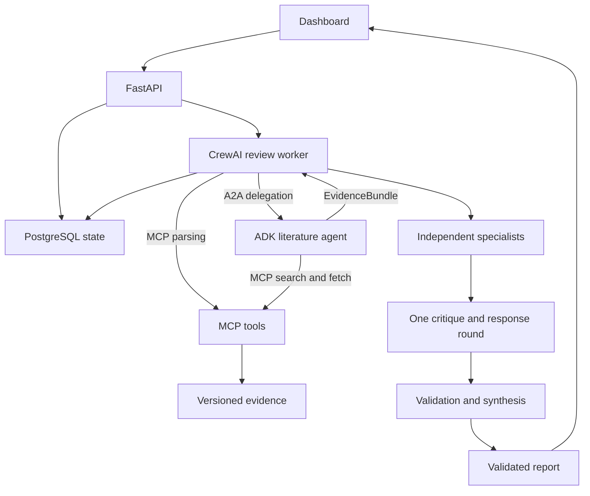

PaperLens implementation plan
Prepared: 21 November 2026
Status: Implementation specification; application, tests, deployment and results are not yet complete.
Companion: Read CODEX_IMPLEMENTATION_GUIDE.md before changing code.
Primary objective: Deliver a working, evidence-grounded academic paper review application for the Agentic AI project.
1. How to use this plan
Implement milestones in dependency order. Each milestone ends with observable acceptance evidence. A file existing, a mocked demonstration, or a successful build alone does not prove that the corresponding capability works.
- [ ] means pending; [x] means implemented and verified with linked evidence.
- Record partial or blocked work in docs/implementation_status.md; do not mark it complete.
- Preserve the supplied reference documents. Record justified design changes in docs/decisions.md and update this plan if the implementation changes.
- The estimates are effort ranges, not deadlines. The actual submission date and available API/cloud budget are not supplied.
- This task creates planning documents only. Implementation begins when the user asks Codex to build the project.
Source of truth and requirement provenance
Source	How to use it
PaperLens_Architecture_and_Methodology.md	Main architecture baseline: seven roles, CrewAI + ADK, MCP, A2A, persistent state, evidence validation, bounded critique, tracing and deployment
PaperLens_Project_Synopsis.pdf	Project purpose, intended users, original scope, team and the paper-first/proposal-later ordering
Course_Handout__Agentic AI.pdf	Deliverables, contribution rotation, public GitHub requirement, viva and academic integrity expectations
Final_Project_Report_Template.pdf	Final report sections and evidence to collect
1.pdf through 7.pdf	Course examples and conceptual guidance; verify any copied API against the chosen dependency versions
This plan	Concrete implementation choices, task breakdown and acceptance criteria derived from the architecture

The 11-item compliance checklist below comes from the existing architecture specification. Do not claim every item is quoted verbatim from the handout. If the instructor provides a newer rubric, reconcile it explicitly. The synopsis may need to be retrieved separately; the key implementation requirements are captured here so Codex can start without access to this chat.
2. Product definition and scope
PaperLens helps students and researchers inspect a paper's contribution, methodology, datasets, experimental support and reproducibility. It returns a structured first-pass critique grounded in the submitted document and retrieved literature. It does not determine publication acceptance, prove global novelty, or replace expert peer review.
Core release: Paper-Critique Mode
1. An authenticated user uploads an English machine-readable PDF or pastes a paper draft.
2. The system validates and parses the submission, preserving page/section/span references.
3. An Orchestrator creates a review plan and delegates literature retrieval to an independent ADK service over A2A.
4. Three specialist reviewers assess novelty, methodology/reproducibility, and dataset/evidence independently.
5. A critic challenges weak findings once. Each challenged owner responds once. A closure pass records dispositions.
6. Deterministic validators verify references, contracts, limits and score consistency.
7. A Communication Agent synthesizes accepted findings into a report; a final validator gates publication.
8. The dashboard displays progress, evidence, comparison tables, critique history, scores, uncertainty and measured execution information. JSON and Markdown exports come from the same report object.
Core boundaries
- Start with empirical CS/AI papers, one submission per review, PDF limit 20 MB / 30 pages.
- Proposed pasted-text limit: 150,000 characters, additionally bounded by the parsing/context budget. Validate this limit against development cases.
- Text-only analysis must disclose inaccessible figures, equations and tables. Never infer unreadable numerical values.
- Use public/open-access literature and authorized user submissions; do not bypass paywalls.
- No OCR, arbitrary web crawler, code execution from papers, local GPU inference, fine-tuning or unlimited discussion.
- No Redis, Kubernetes, additional agent framework, separate vector database, chat assistant or custom authentication platform in the first release.
- PDF export, SSE updates and extra providers are optional polish after core acceptance.
Extension: Problem-Assessment Mode
Add only after M0-M5 pass. Require an explicit mode selection. Assess the proposed problem, closest work, research gap, data access, methodological feasibility and planned validation. Mark actual experimental evidence not applicable. Use a distinct rubric version; never compare its aggregate numerically with a paper review. Unsupported modes return an explicit validation error until implemented.
3. Architecture and fixed decisions
Component	Decision	Responsibility
Frontend	React + TypeScript + Tailwind; Vite build	Upload, progress, report, citations and exports
Web/API	FastAPI + Pydantic v2	Authentication, ownership, submissions, run commands, status and report delivery
Workflow	CrewAI Flow in a dedicated worker	Deterministic stage order, six CrewAI roles, checkpoints and bounded review
Retrieval agent	Google ADK in a separate process/service	Literature search planning and evidence assembly
Agent boundary	Official A2A client/server support	CrewAI delegation to ADK with typed request/result artifacts
Tools	Official MCP SDK over Streamable HTTP	Parsing, literature queries, safe fetching and evidence lookup
Database	PostgreSQL + pgvector, SQLAlchemy and Alembic	Durable state, vectors, provenance, cache, audit and recovery
Object storage	Local authorized directory in development; private Cloud Storage in cloud	Original documents, snapshots and exports
Model	Configurable hosted provider, Groq candidate from architecture	Verify tool calling, structured output and usage accounting during M0
Embeddings	CPU sentence-transformers candidate	Pin model revision, dimension, tokenizer limit and license after spike
Observability	Langfuse + OpenTelemetry + application audit records	Correlated distributed traces and durable operational evidence
Local runtime	Docker Compose	API, worker, ADK, MCP and PostgreSQL
Cloud runtime	Cloud Run web/API, review Job, private ADK/MCP; Cloud SQL and Storage	Durable deployment with authenticated service boundaries

Use separate Python projects/lockfiles for API, worker, ADK and MCP. Shared contract/storage utilities must not pull CrewAI into ADK or ADK into the worker. Use one small shared Python package installed in service images. Select an interpreter supported by all pinned packages; Python 3.12 is a candidate, not a compatibility guarantee. Pin a compatible Node LTS and package manager in the frontend.

Do not freeze guessed framework versions in this plan. M0 must resolve and lock a working combination of CrewAI, ADK, A2A SDK, MCP SDK, Pydantic, model connector and telemetry integrations. Document exact versions, protocol revisions, Agent Card discovery path and transport behavior. SDK/protocol details change; use official documentation matching the installed release.

Seven logical roles
Role	Framework	Output	Restrictions
Orchestrator	CrewAI	ReviewPlan	Cannot skip stages, increase budgets or create extra roles
Literature Retrieval	ADK	EvidenceBundle	At most one query reformulation cycle within total search budget
Novelty & Gap	CrewAI	Novelty DimensionReview	Compare eligible prior work; similarity is not a novelty score
Methodology & Feasibility	CrewAI	Methodology and reproducibility DimensionReview objects	Distinguish reported methods from inferred deficiencies
Dataset & Evidence	CrewAI	Evidence DimensionReview	Check splits, leakage, metrics and claim/result alignment
Limitations & Critique	CrewAI	CritiqueBatch, then CritiqueClosure	One challenge pass and one closure pass; no fresh debate in closure
Communication	CrewAI	Structured synthesis	No new findings, sources, numerical scores or hidden dismissal of objections

Flow control code and MCP tools are not additional LLM agents. The Orchestrator performs ingestion via an MCP-backed tool and delegates retrieval via its A2A tool; the Flow verifies the resulting protocol evidence before advancing. Specialists receive the same frozen evidence snapshot and do not see one another's initial findings.
4. Repository structure
Create these paths during implementation; they are not all present yet. Adapt to an existing implementation if one is discovered, instead of duplicating it.
Path	Contents
plan.md, CODEX_IMPLEMENTATION_GUIDE.md	Implementation contract and operating guide
apps/api/	FastAPI routes, auth adapter, dispatch adapters, API dependencies, tests and Dockerfile
apps/web/	React views/components, generated API types, frontend tests and package lock
services/review_worker/	CrewAI roles, Flow, A2A client tool, synthesis and worker entry point
services/literature_adk/	ADK agent, persistent sessions, A2A exposure and task store
services/mcp_tools/	MCP server, parsers, provider clients, safe fetcher and embeddings
packages/paperlens_core/	Contracts, repository interfaces, budget ledger, scoring, citation validation and telemetry helpers
migrations/	Alembic revisions for app tables and pgvector; ADK-owned schema handled separately
prompts/	Versioned role prompts and structured-output instructions
rubrics/	Paper rubric with dimension-specific anchors; proposal rubric only with extension
evaluation/	Dataset manifest, labels, adjudication, experiment configs and metric code
tests/unit/, tests/integration/, tests/e2e/, tests/security/	Invariant and boundary checks
tests/fixtures/	Small synthetic or licensed fixtures; distinguish fixtures from live evidence
infra/	Compose configuration, cloud manifests/scripts, service identity policies
scripts/	Bootstrap, checks, migration, smoke, evaluation and cleanup entry points
docs/	Decisions, implementation status, compatibility, operations, evaluation protocol, report evidence and contributions
var/	Ignored local uploads, artifacts and scratch data
.env.example, .gitignore, README.md	Reproducible setup and safe defaults

Keep contracts in one authoritative Python package. Generate frontend types from OpenAPI or checked-in JSON Schemas; do not maintain incompatible hand-written copies. Include a schema_version in persisted artifacts and A2A application payloads.
5. Contracts, data and invariants
Required typed contracts
Contract	Required fields/behavior
Submission	ID, owner, type, object reference, SHA-256, byte count, created time; selected assessment cutoff
ParsedDocument	Document/version ID, pages, sections, stable chunks, parser version, warnings, content hash and extraction coverage
ReviewPlan	Claims with submission references, questions, domain, method/data summary, search queries, mode, cutoff and rubric version
RetrievalRequest	Schema version, run/request IDs, claims, queries, selected authorized context, cutoff, deadline and remaining limits
SourceRecord	Canonical/provider IDs, DOI/arXiv IDs, title/authors, publication dates, URL, retrieved time, content hash and access status
EvidenceChunk	ID, source/version ID, raw and normalized text, page/section/span locator, parent passage, embedding metadata
EvidenceBundle	Sources/chunks or immutable references, queries/results, eligibility, retrieval errors, coverage, bundle hash and provenance
EvidenceRef	Source ID, chunk ID, source kind, source version, quote and exact normalized span offsets; readable locator
Finding	Stable ID, owner, dimension, version, claim, rationale, status, severity, evidence refs, uncertainty and suggested action
DimensionReview	Dimension, assessability, score or null, findings, rubric version and uncertainty
AgentReviewBundle	Agent identity and exactly its assigned dimension reviews
CritiqueBatch	Round 1, challenge IDs, target finding/version, owner, concern and required resolution
RevisionResponse	Challenge IDs, owner, response type, rationale, revised finding versions and source refs
CritiqueClosure	Disposition for every challenge, final version pointers and unresolved issues
ReviewReport	Run/version, overview, contributions, comparisons, dimensions, findings, actions, objections, citations and execution metadata
ReviewState	Stage/version, artifact refs/hashes, review outputs, round, budgets, error records and trace correlation
ErrorEnvelope	Stable code, safe message, retryable flag, details without secrets and correlation ID

Use Pydantic validation with unknown fields rejected at strict boundaries. Do not accept model-generated owner IDs, object locations, run identities or scores as authoritative control data; inject/verify these server-side.
Findings and citations
- Finding status is supported, inference or unverified; source kind separately identifies submission/literature.
- Supported findings and inferences require evidence. An inference is explicitly labelled and cites its premises.
- A validator loads each referenced chunk from the authorized run snapshot, checks source version, span bounds and quote agreement under a documented normalization function.
- Reject cross-run/cross-owner chunks, fabricated IDs and altered quotations. Repeated quotes require an explicit span, not a substring-only match.
- Existence of a matching quote establishes reference validity, not semantic support. The critic and human evaluation assess whether the conclusion follows.
- Missing detail is phrased as “not reported in the provided sections”; do not claim an experiment was never conducted.
- Submission evidence can support a methodology finding without an external citation. A novelty comparison needs evidence from eligible literature and the submitted claim.
- Unverified findings cannot justify a confident score or a factual claim in the executive assessment.
- Use stable server-assigned finding IDs; revisions create immutable versions and preserve links to prior findings.
Scores and assessability
Four dimensions: novelty, methodology, evidence, reproducibility. A score is an integer 1-5 only when assessability=assessed; otherwise it is null. No missing dimension is silently treated as zero.

Create a versioned rubric with full anchors for 1-5. Starting anchors to refine on development papers:
Dimension	1	3	5
Novelty	Central contribution substantially overlaps eligible prior work without a supported distinction	Some distinction, but material overlap remains	Clear supported distinction within adequately covered eligible literature
Methodology	Documented design flaws substantially undermine the main conclusion	Plausible design with material controls or baseline gaps	Appropriate design, comparisons and assumptions for the stated claims
Evidence	Documented results fail to support central claims	Partial support with material uncertainty or missing checks	Reported evidence supports the scoped claims with appropriate uncertainty checks
Reproducibility	Important reported omissions prevent meaningful reproduction	Main procedure understood but key implementation/data details missing	Sufficient accessible procedural details and artifacts within the assessed scope

Scores 2 and 4 represent documented intermediate cases and must receive their own written anchors. Weak retrieval is an evidence-coverage problem, not evidence of low novelty.

Optional rubric index, only with four assessable scores:

20 * (0.30 * novelty + 0.30 * methodology + 0.25 * evidence + 0.15 * reproducibility)

Range is 20-100, not 0-100. Compute it in code and label it a rubric index, not acceptance probability. Recommendation rules are proposed defaults: insufficient_evidence when a dimension is unassessable or a critical objection prevents assessment; otherwise revision_recommended when an unresolved major issue or score <= 2 exists; otherwise ready_for_further_expert_review. Keep the rule versioned and visible; it is not a venue decision.
Persistence and transaction boundaries
Implement tables for submissions, review_runs, run_checkpoints, documents, document_chunks, run_sources, findings, finding_versions, challenges, responses, reports, audit_events, provider_cache, a2a_tasks, model_calls and dispatch_outbox. Use a separate schema/namespace for ADK-managed sessions.
- All user-owned records have explicit ownership and foreign-key scope. Add run/source membership checks where private and public evidence meet.
- Keep original object bytes and derived artifacts immutable; store hash, size, MIME type and storage key.
- Stage idempotency key: run ID + stage name + branch/owner where applicable + input hash + configuration version.
- Persist accepted stage output and next state version in one database transaction.
- Parallel reviewers return independent artifacts; only the coordinator merges the aggregate under optimistic version checks.
- A run lease has owner, expiry, heartbeat and monotonically increasing fencing token. Every worker write verifies its lease token and state version; an expired worker cannot overwrite its replacement.
- Keep checkpoints at stage boundaries. Recovery may repeat an interrupted external call, but must not pretend to resume inside a model generation.
- Caches include provider, normalized query, filters, cutoff, parser/model version and expiry. Public metadata caching must not expose private prompts or submission contents.
- Pin embedding dimension/model revision with vectors; a model change requires a new index or migration/re-embedding, not mixing incompatible vectors.
6. Workflow, limits and failure policy
Stage machine
Normal stage order:

queued -> parsing -> planning -> retrieving -> reviewing -> challenging -> revising -> closing -> validating -> synthesizing -> publishing -> completed

Run status is separate from stage: queued, dispatch_pending, running, needs_input, failed, cancelling, cancelled, completed. Completion includes complete or limited_evidence report quality. Keep technical failure distinct from a scientifically inconclusive but valid report.
Event	Required transition/behavior
Empty/unsupported extraction	needs_input; provide actionable message; do not spend review calls
No eligible literature, successful search	Continue only with explicit limited-coverage state; novelty null where unassessable
All retrieval providers fail	Record technical failure; bounded retry, then failed/retryable run rather than claiming no prior work exists
One specialist fails after repair/retry budget	Core default: fail run with checkpoint retained; no apparently complete report with a missing reviewer
No critic challenges	Persist empty batch, skip owner calls, deterministic empty closure, continue
Challenged owner times out	Keep original finding plus unresolved objection; prevent confident promotion of disputed claim
Closure model output fails	Preserve all remaining challenges as unresolved through a deterministic fallback; disclose closure failure
Synthesis introduces unsupported content	Reject output, one repair within budget; fail publication if still invalid
Budget/deadline exceeded	Cancel outstanding work where possible; terminal failed state with budget_exceeded or deadline_exceeded
Cancellation requested	Persist cancellation first, stop admission of new calls, propagate cancellation/deadlines; discard late results
Telemetry exporter unavailable	Continue with durable audit trail and telemetry warning; do not fabricate a complete trace
Worker dies	Reconciler detects stale heartbeat; reacquire lease and resume matching checkpoints, subject to run deadline

Initial configurable limits
Limit	Default
PDF size/pages	20 MB / 30 pages
Initial search queries	3
Total search tool invocations including reformulation and retried invocations	6
Candidate records / retained works	30 / 12
External full-text documents	5
Critique rounds	1
Challenges	Up to 6; at most 2 per specialist owner
Owner revision calls	At most 1 substantive response per challenged owner, addressing all its challenges
Concurrent model calls per run	2
Global model request attempts per run	35, including nested retries and format repair
Format repair	At most 1 per failed stage/owner output
Transport retries	At most 2 per transient call, additionally bounded by global limits
Application deadline / Cloud Job timeout	10 / 15 minutes
ADK retrieval deadline	At most 180 seconds and no later than remaining run deadline
Initial active runs	1 per owner; 2 across the prototype deployment

Distinguish tool invocations from provider HTTP attempts; count and cap both. Choose a finite provider HTTP-attempt cap in M0/M1 based on provider fan-out (proposed 18 search HTTP attempts/run). Internal framework retries must use the central ledger or be disabled. A retry must not multiply budgets across services.

Before each model call atomically reserve call count and token/cost allowance. Track success, failure, usage unknown and released/consumed reservations. Never report an unmetered call as zero-cost. Set an explicit finite token ceiling after a development run and before cloud release; do not assume the architecture's illustrative token totals fit every model. Count billable reasoning tokens where reported. Costs depend on a dated pricing configuration, never a hard-coded claim that inference is free.
One-round critique algorithm
1. Store the three initial reviewer bundles and freeze their finding versions.
2. Critic produces round-1 challenges targeting existing findings or a clearly identified omission assigned to an owner. For omission challenges, use an explicit typed target variant; do not invent a finding ID.
3. Validate target/owner consistency and caps before invoking owners.
4. Invoke each challenged owner once with all of its challenges and the same evidence snapshot. Response can defend, revise, retract or remain unresolved.
5. Validate revised findings and score changes; preserve every prior version and retraction.
6. Critic closes existing challenges with accepted/rejected/unresolved dispositions. Reject any new challenge in closure.
7. Freeze final finding versions. A code-level round guard prevents another substantive round even after restart or output repair.
Formatting repair may only fix serialization/schema errors using the same substantive task and evidence; count it separately from debate while including its model cost.
7. Ingestion and literature retrieval
Ingestion tasks
- Validate actual PDF signature and readability, not extension alone. Stream byte limits; reject encrypted/corrupt/oversized documents explicitly.
- Generate storage IDs; never use untrusted filenames as filesystem paths. Run parser work with time/memory limits and no document scripts.
- Primary parser: pdfplumber; fallback: pypdf. Preserve page order, paragraphs, sections and trustworthy table text with extraction warnings.
- Detect low usable-text coverage and suspicious reading order; calibrate threshold on development cases and record the chosen policy.
- Pasted text receives stable section/paragraph/character locators rather than fabricated page numbers.
- Keep raw extraction and normalized citation text with their mapping/version. Remove headers/footers conservatively.
- Start with readable parent passages around 500-800 tokens. Create smaller embedding subchunks that fit the actual embedding tokenizer; retain parent IDs. Never silently truncate long passages to MiniLM's input limit.
Literature tasks
1. Integrate OpenAlex and arXiv first. Optional Semantic Scholar requires its available access; Crossref is optional metadata verification.
2. Read current official auth/rate-limit rules during implementation. Use provider adapters, finite timeouts, Retry-After handling, bounded backoff and caching.
3. Deduplicate by normalized DOI, arXiv family/version and normalized title; preserve merged provenance and record uncertain matches.
4. Exclude the submission and its own preprint/published versions from prior-work novelty comparisons. Keep them as identity/provenance records if useful.
5. Separate publication/first-availability dates and assessment cutoff. Unknown dates are ineligible for confident prior-work claims until resolved. Later work may appear only as explicitly retrospective context.
6. Use lexical and embedding retrieval with a documented rank-fusion rule, such as reciprocal-rank fusion with a versioned constant. Apply cutoff/identity eligibility before selecting novelty evidence.
7. Retain up to 12 works, aiming for 8-12 when coverage permits; do not fabricate papers to meet a quota. Explain the difference from the synopsis's broader 10-15 target in design decisions.
8. Fetch up to five accessible full texts through approved provider locations. Abstract-only records remain useful for limited topic comparisons, with the limitation visible.
9. Store queries, rank scores, selection decisions, provider errors, URLs, retrieval dates and hashes. Freeze the final bundle before review.
10. Retrieval reformulation is allowed once if coverage is inadequate, within all caps. ADK must return a valid partial bundle or a typed failure, not loop indefinitely.
Safe fetch policy
No arbitrary user/model URL fetching. Fetch by resolved source ID through an allowlisted provider adapter. Require HTTPS, check host/address at each redirect, reject credentials in URLs and private/loopback/link-local/metadata destinations, enforce byte/MIME/time limits and restrict redirect count. Use network/egress controls where available to reduce DNS-rebinding risk. Do not let a paper's text alter tool names, service URLs, auth or fetch policy.
8. MCP and A2A implementation
MCP tool surface
Tool	Input	Output and caller
parse_document	Authorized submission/object ID, run context	ParsedDocument; Orchestrator
search_literature	Bounded query, cutoff, provider filters and limit	Candidate records + provider status; ADK
fetch_paper_evidence	Authorized source ID and bounded fetch options	Versioned passages + access status; ADK
lookup_paper_metadata	DOI/arXiv/provider ID	Canonical metadata; ADK
search_evidence	Run/snapshot reference, bounded query and top-k	Existing authorized chunks; ADK or explicitly enabled reviewer

Authenticate service identity and propagate a trusted run scope. An agent-supplied owner field is not authorization. Restrict discovered tool names, validate all arguments and results, cap result bytes and return typed errors. Demonstrate parse_document and search_literature as actual MCP client/server calls. Unit tests can call implementation functions, but those tests do not prove protocol integration.

Use Streamable HTTP locally and in cloud for the integration gate. If stdio is used temporarily, retain separate HTTP integration tests. Pin both client/server protocol behavior rather than mixing example versions.
A2A boundary
- Expose the ADK retrieval agent through its supported A2A integration and official SDK types.
- Implement a thin CrewAI tool around the official A2A client. Do not replace A2A with an ordinary custom /retrieve endpoint or direct Python import.
- Discover an allowlisted Agent Card and verify expected skill, endpoint, transport and security configuration.
- Send RetrievalRequest as structured application data. Persist request ID, protocol message/task/context IDs, run ID and trace linkage.
- Return an EvidenceBundle artifact or immutable authorized object reference with a hash. Validate identity, schema, provenance and hash before accepting it.
- ADK owns its persistent session; CrewAI owns its Flow state. Only validated explicit artifacts cross the boundary.
- Prefer a bounded request/result path for the first spike. If using asynchronous tasks, persist task/results and use SDK task polling, not an in-memory-only store.
- Deduplicate repeated request IDs. Cancellation/expiry prevents late results from updating the run. Never accept remote state deltas as permission to mutate arbitrary local fields.
- In cloud, the worker authenticates to ADK, and ADK/worker authenticate to MCP with service identities. Verify identity-token audience handling in M0/M4.
9. API and user interface
Version application routes under /api/v1; health routes are separate. Validate ownership on every read, write, event, citation and export route.
Method/path	Behavior
POST /submissions	Multipart PDF or separate JSON text content type; exactly one input; return submission ID
POST /reviews	Submission ID, mode, cutoff and options; idempotency header; return 202 + run/status URL
GET /reviews	Paginated owner-scoped history
GET /reviews/{run_id}	Status/stage, stage completion, warnings, timings and report availability
GET /reviews/{run_id}/events	Paginated sanitized events with cursor; polling first
GET /reviews/{run_id}/report	Published validated report only; conflict/not-ready response otherwise
GET /reviews/{run_id}/sources/{source_id}/chunks/{chunk_id}	Authorized citation excerpt and provenance
GET /reviews/{run_id}/export?format=json|markdown	Deterministic download from published report
POST /reviews/{run_id}/cancel	Idempotent cancellation request; completed runs remain completed
GET /health/live, GET /health/ready	Process liveness and required dependency readiness without secrets

Prefix table paths with /api/v1 except health endpoints. Return consistent 401/403 or non-disclosing 404 for unauthorized objects, 413 for oversized uploads, 422 for invalid requests, 409 for idempotency/state conflicts and 429 for admission limits. Same owner + same idempotency key + same request hash returns the original run; a changed payload with the same key conflicts.
Authentication decision
Use a small Principal interface and a supported OIDC provider integration for cloud. Validate issuer, audience, signature and expiry using maintained libraries. A fixed development user is allowed only in explicitly local mode; startup must reject that bypass in cloud mode. Never trust an arbitrary browser-supplied X-User-ID. Keep provider secrets off the frontend. Choose cookie/CSRF or bearer-token handling explicitly in M4 and document its security behavior.
Dashboard requirements
- Submission form: PDF/text choice, scope limits, assessment cutoff and explanation, launch action, actionable validation errors.
- Progress: actual current stage and completed stages, elapsed time, cancel, retry guidance and warning details. No invented completion percentage or fake countdown.
- Report: executive assessment, four dimension cards, findings grouped by severity, comparison table, prioritized actions and unresolved objections.
- Evidence drawer: source title, authors/year, URL, access status, quote, page/section/span and evidence role.
- Critique view: original finding, challenge, response, revised finding and final disposition.
- Execution view: model/config version, token counts, cost estimate with missing-usage warning, duration, evidence coverage and trace reference where authorized.
- History/export: owner-scoped previous runs; JSON/Markdown downloads; empty, loading, failure, cancelled and limited-evidence states.
- Accessibility: keyboard navigation, labelled form controls, visible focus, readable contrast and non-color status labels.
- Render Markdown safely; disable raw HTML or sanitize it. Escape citations and protect external links.
10. Observability, security and cost controls
Record a root review trace and nested stages, agent tasks, model requests, MCP calls and A2A exchanges. Propagate W3C trace context and preserve async-job linkage; shared run IDs alone are insufficient for distributed tracing. Choose one instrumentation path per framework to avoid duplicate spans.

Callbacks record timestamps, run/stage/agent/framework, correlation IDs, artifact hashes, tool name, model, attempt, latency, token usage, validation outcome and sanitized error codes. Capture errors at execution boundaries too. Persist an append-only audit trail independently of telemetry export. Log evidence and concise justifications; do not require hidden model chain-of-thought.

Apply authentication, ownership checks, strict contracts, PDF limits, safe fetching, secret redaction, output sanitization and bounded tools. Treat all uploaded/retrieved text as untrusted data. Injection heuristics may flag suspicious content, but permission and workflow boundaries must remain effective even when detection fails. Legitimate quoted offensive text in research should not automatically block analysis.

Document retention and deletion across originals, chunks, vectors, reports, caches and traces; use a configurable prototype policy, proposed 30 days for private artifacts. Record trace prompt-capture settings and external LLM/telemetry processing in the README/UI information. Never commit credentials, .env, private papers, raw private traces or database dumps to the public repository.

Cost output must distinguish provider usage cost, cloud execution estimate and allocated fixed infrastructure costs. Store pricing date/currency and unknown usage explicitly. Configure Cloud Run maximum instances, small database pools, per-owner admission and a database-backed global active-job cap. Billing alerts are notifications, not spending enforcement.
11. Milestones and acceptance gates
M0 — Repository foundation and interoperability spike
Dependencies: None. Estimated effort: 2-3 person-days, subject to API compatibility.
- [ ] Inspect existing files/code and preserve user work. Create status/decision records and dependency projects.
- [ ] Implement the smallest contract package, health endpoints, local PostgreSQL and Docker Compose startup.
- [ ] Run one real CrewAI Orchestrator task and one independent ADK retrieval agent.
- [ ] Complete official A2A discovery, request and typed result across separate processes.
- [ ] Call parsing and literature-search tools through real MCP transport; use a small public/synthetic document and one live provider query.
- [ ] Verify selected model tool calling, structured output/repair behavior and usage reporting in both frameworks.
- [ ] Capture a trace crossing worker, A2A, ADK and MCP; add an intentional malformed result test.
- [ ] Pin compatible dependencies, protocol revisions and model settings in lockfiles and docs/compatibility.md.
Exit: docs/evidence/m0.md links commands, passing protocol tests, sanitized trace/artifacts and exact versions. A fixture-only spike is useful progress but does not satisfy the live gate. Resolve this milestone before implementing all specialist prompts or polishing the UI.
M1 — Ingestion, evidence and storage
Dependencies: M0. Effort: 3-5 person-days. Begin human labelling in parallel with development, without using held-out labels for prompt tuning.
- [ ] Create migrations, ownership repositories, object-store adapters and immutable artifact storage.
- [ ] Implement PDF/text ingestion, parser fallback, locators and low-text/unsupported states.
- [ ] Add OpenAlex/arXiv adapters, deduplication, cutoff filters, submission identity exclusion and safe fetching.
- [ ] Implement embeddings/subchunks, PostgreSQL full-text retrieval, pgvector ranking and versioned rank fusion.
- [ ] Implement provider cache, bounded retry/call accounting and source provenance.
- [ ] ADK returns frozen validated EvidenceBundle over A2A, including abstract-only and partial-coverage cases.
- [ ] Create development/held-out manifests with licenses and source dates; start reference annotations.
Exit: A supported document produces searchable, exactly locatable passages; a citation resolves to original evidence; no-result, abstract-only and unavailable-provider states remain distinct. Cross-owner retrieval and private-cache tests pass.
M2 — Core specialist review and deterministic reports
Dependencies: M1. Effort: 3-5 person-days.
- [ ] Implement ReviewPlan and explicit stage transitions with persistent checkpoints.
- [ ] Implement novelty, methodology/reproducibility and evidence reviewers with independent initial context.
- [ ] Version prompts, dimension anchors and finite budgets; add global admission/semaphore and call ledger.
- [ ] Implement finding/reference validation, score/assessability consistency and deterministic scoring.
- [ ] Add Communication synthesis with source/finding allowlists, followed by strict publication validation.
- [ ] Implement JSON/Markdown rendering and minimal API retrieval for a completed report.
- [ ] Save lineage from final claim to finding version, task/prompt and source chunk/hash.
Exit: A real review yields a schema-valid report with four dimension objects, validated references and identical scores across API/exports. Forged citations and unsupported synthesis fail publication. M2 is a partial pipeline and must not be presented as the final one-round system.
M3 — Bounded critique, recovery and cancellation
Dependencies: M2. Effort: 3-4 person-days.
- [ ] Implement challenge caps, target validation, owner response bundles, immutable revisions and closure.
- [ ] Enforce the one-round invariant in code/database across restart and repair.
- [ ] Implement worker leases/fencing, transactional state versions, stage reuse and duplicate-dispatch handling.
- [ ] Add cancellation, deadlines, stale-run reconciliation and terminal failure policies.
- [ ] Exercise reviewer failure, owner timeout, malformed closure, rate limits and telemetry outage.
Exit: A run shows original/challenged/revised findings; no challenge generates a second substantive round. Duplicate workers cannot double-publish; a cancelled run rejects late responses; restart resumes valid checkpoints. Empty challenge sets and unresolved objections render honestly.
M4 — Complete UI and cloud deployment
Dependencies: M3; minimal frontend shell may begin earlier. Effort: 3-5 person-days.
- [ ] Implement all core API contracts, authentication, owner isolation and idempotency behavior.
- [ ] Implement the dashboard states, citation drawer, comparison/critique views and exports.
- [ ] Add tested PowerShell/local setup commands, container builds and database migrations.
- [ ] Implement dispatch outbox and local/cloud execution adapters using the same run logic.
- [ ] Prepare Cloud Run web/API, review Job, private ADK/MCP, Cloud SQL/pgvector, private Storage and Secret Manager configuration.
- [ ] Verify service identities, region, connection pools, retention, readiness, budgets and startup configuration validation.
- [ ] Run authenticated upload-to-report flow on cloud, inspect source citations, trace and measured usage.
- [ ] Record deployment, rollback, teardown and troubleshooting commands; verify private service rejection and cross-owner denial.
Exit: A reproducible local run and a genuine cloud run complete through the UI. No cloud work lives solely in an ephemeral API background thread. If cloud credentials/budget are missing, mark cloud verification blocked while completing local work and deployment artifacts.
M5 — Evaluation, documentation and submission package
Dependencies: M4 for live cloud metrics; reference labelling begins in M1. Effort: 4-6 person-days, plus annotation time if needed.
- [ ] Finalize held-out labels, matching/adjudication rules and evaluation protocol before held-out runs.
- [ ] Implement B0-B3 configurations and metric aggregation with explicit denominators.
- [ ] Run planned repeated experiments within the approved API budget; store failures and raw results.
- [ ] Separately measure live retrieval, cold/warm cloud latency and usage/cost.
- [ ] Produce actual result tables, error analysis and release-target pass/fail statements.
- [ ] Complete README, architecture/protocol/deployment diagrams, report material, demo script and contribution evidence.
- [ ] Prepare a clean public-repository candidate after secret/private-data checks; publish only when authorized.
- [ ] Prepare a genuine recorded demo backup and document how each member can explain/modify core components.
Exit: Every release checklist item has evidence or an explicit unmet status. No estimated metric, mocked trace or planned feature is represented as an experimental result.
M6 — Optional proposal assessment
Dependencies: Accepted M0-M5. Effort: 2-3 person-days.
- [ ] Add explicit proposal mode/schema/rubric and mode-aware context routing.
- [ ] Reuse retrieval/novelty/feasibility with data-access and validation-plan checks.
- [ ] Suppress claims about experiments that do not exist; mark empirical evidence not applicable.
- [ ] Evaluate at least three diverse proposal cases and verify separate score semantics.
Exit: Proposal reports are correctly labelled and cannot be mistaken for reviews of completed research. Otherwise leave the mode unavailable.
Scope control under time pressure
Reduce extra provider integrations, PDF export, visual polish, SSE, optional proposal mode and experiment repetitions only with an explicit documented scope decision. Preserve actual frameworks/protocols, evidence validation, one-round critique, ownership, persistence and honest evaluation. Do not silently call a reduced demo the full release. Total core estimates sum to 18-28 person-days and are not a claim about calendar completion.
12. Test and evaluation design
Automated checks
Layer	Meaningful required cases
Contracts/unit	Invalid schema, duplicate/missing dimensions, wrong owner, unknown source, quote mismatch, score/null consistency, score formula boundaries, round cap
Parsing/retrieval	Corrupt/encrypted/scanned/oversized PDF, pasted text locators, duplicate source families, cutoff exclusion, abstract-only source, embedding length and safe redirects
Integration	Real MCP calls; A2A Card/request/artifact; persistent ADK session; DB/pgvector; cache scope; source authorization
Recovery	Duplicate dispatch, expired lease with fencing, stale heartbeat, resumed stage input mismatch, cancellation and late result, provider 429/timeouts
Security	Cross-owner access on all routes, forged run/source context, PDF injection, malicious citation Markdown, prohibited fetch targets, redacted secrets
End-to-end	Upload -> report -> citation -> export; failure/needs-input/cancel states; live smoke separate from deterministic CI
UI	Keyboard form use, accessible labels, real progress, limited-evidence warnings and no stale report on run switch

Use deterministic fixtures for CI and business invariants. Live tests require explicit configuration, consume real budgets and retain sanitized evidence. Mocked model outputs must be labelled fixture mode in UI/artifacts. A passing mock test does not count as a live framework, provider or cloud check.
Human evaluation protocol
- Preferred corpus: 15 open-access empirical CS/AI papers, 5 development + 10 held-out. If only 10 can be labelled well, use 4 + 6 and report the reduction.
- Choose varied paper quality/topic/method so always criticizing is not rewarded. Record license, hash, source, cutoff and split in a manifest.
- Two people independently label limitations, method overlap and evidence concerns before seeing system output; a third adjudicates disagreements. Record agreement and decision rules.
- Keep evaluation labels and later critiques separate from assessed retrieval snapshots. Later work may inform retrospective reference labels only when explicitly declared.
- Freeze prompts/rubrics before held-out experiments. If tuning follows held-out inspection, report contamination and obtain a fresh test set or label subsequent results exploratory.
- Adjudicate plausible additional findings; absence from the initial reference labels does not automatically make a new finding false.
Condition	Configuration
B0	One CrewAI reviewer, submission only
B1	One CrewAI reviewer with frozen retrieved evidence
B2	Three specialists with that evidence, no critique
B3	Full three-specialist system plus one critique/revision round

Keep model, rubric and output schema consistent. B1-B3 use the same evidence snapshot per paper. Log different call/token budgets. Preferred run count: 10 held-out papers x 4 conditions x 3 repeats = 120 review attempts. Report failures and retries; do not hide them by replacing failed attempts. Record repeat/seed metadata where supported, without claiming deterministic model outputs.
Metrics and reporting
- Limitation precision = valid adjudicated findings / adjudicated flagged limitations.
- Recall = matched eligible labelled limitations / eligible labelled limitations; define duplicate/matching rules first.
- F1 = harmonic mean; define zero-denominator outcomes explicitly, with counts and N/A where appropriate.
- Citation validity = resolvable authorized source spans / all references.
- Citation support = human-supported factual claims / adjudicated claims presented as supported.
- Unsupported assertion rate = unsupported confident factual assertions / factual assertions assessed.
- Retrieval recall@10 = known relevant eligible sources found in top 10 / known relevant eligible sources.
- Novelty agreement = human/system ordinal agreement and absolute score differences on assessable cases.
- Critique benefit = paired B3-B2 changes, including errors corrected and errors introduced.
- Operational success = completed valid reports / attempted supported inputs; distinguish unsupported-input rejection.
- Trajectory compliance = required protocol stages and critique bounds observed in traces/events.
- Runtime = queue, startup, each stage and submission-to-publication wall time, with median/p95 and sample size.
- Cost = model/provider usage including retries + execution estimate + allocated infrastructure; identify unmeasured components.
Publish per-paper data and sample counts. Three repeats are not three independent papers. If estimating uncertainty, resample by paper; small-sample p95 is descriptive. Treat an LLM judge as a secondary analysis, never the only reference truth. Frozen-retrieval experiment latency must not be labelled live end-to-end latency.
Release targets, not achieved results
Target	Evidence needed
100% published report schema and reference resolution	Publication-gate checks + all saved reports validated
One-round and owner-isolation invariants hold	Automated adversarial/recovery tests
At least 90% operational success on supported cases	Actual attempted/completed counts
Aim for >=90% human support among supported claims	Independent adjudication with denominators
Aim for positive B3 versus B2 quality difference	Paired evaluation; report negative/neutral results honestly
Usable local and cloud demonstration	Recorded real runs, commands, trace links and artifacts

13. Deployment and operations
Cloud topology: FastAPI serves compiled React assets; each review uses one Cloud Run Job task; ADK and MCP are private services; PostgreSQL/pgvector is Cloud SQL; files are private Cloud Storage objects. Use least-privilege service accounts and Secret Manager. Keep one region recorded in deployment config.

Persist run and outbox entry before dispatch. A dispatcher/reconciler claims pending outbox records and launches the same run ID. Lost dispatch responses may cause another launch; the database run lease ensures only one current execution writes. Periodic reconciliation, plus status checks, clears stale launch/running states. Local mode uses a worker polling the same durable queue. Cancellation is persisted regardless of cloud cancellation API success.

Initial sizing from the architecture is a measurement starting point: worker/MCP 1 vCPU and 2 GiB, ADK 1 vCPU and 1-2 GiB, small non-HA Cloud SQL. Confirm library/model memory during container tests. Bake or reliably preload the embedding model with a pinned revision; do not download it on every request. Cloud SQL can accrue costs while compute services are idle.

Provide:
- Setup, migration and rollback instructions from a clean checkout.
- Separate development and cloud configuration with required-variable validation.
- Deployment script supporting a dry-run/plan output and explicit project/region settings.
- Health checks, DB-pool limits, job timeout/retry settings and object lifecycle policy.
- A reconciliation schedule/worker and diagnostic commands for stuck runs.
- Safe teardown instructions that identify retained database/artifact data before deletion.
- Known-failure guidance for missing model keys, provider limits, auth audience mismatch, parser failure and unavailable telemetry.
14. Course evidence, team and final deliverables
Baseline requirement	Proof to retain
Context/state changes	Checkpoint versions and EvidenceBundle-to-reviewer transfer
Two or more MCP tools	Discovery and real parsing/search call records
Pydantic outputs	Schemas, valid artifacts and rejected malformed output
Agentic patterns	Planning, retrieval, independent reviews, bounded critique and annotated graph
Callbacks	Agent/model/tool events, intermediate artifacts, durations and an error example
A2A interoperability	Agent Card, task/message correlation and validated result artifact
CrewAI and ADK	Actual service imports/lockfiles and cross-framework run
Guardrails	Injection, ownership, citation, quotas and malformed-tool tests
Observability	Correlated trace plus source-to-finding provenance
Evaluation/time/cost	Actual B0-B3 results, live measurements and cost accounting
Cloud deployment	Live authenticated run and deployment evidence

Initial responsibilities follow the synopsis; rotate implementation/review work at milestones and log actual contributions:
Member	Initial lead	Cross-component work
Mohammad Yakub, 230477	Flow, state, API and A2A client	Retrieval/guardrail review and one evaluation component
Himanshi Chaturvedi, 230474	ADK, MCP providers and ranking	Recovery test, trace propagation and scoring review
Ananya Pandey, 230472	Specialist/critic logic and evidence UI	Citation validation, deployment test and A2A lifecycle explanation

Do not prefill completed contribution claims. Each member needs technical work across components and the ability to explain/modify the system. The handout explicitly addresses AI-generated code and academic integrity: the team must follow instructor policy, attribute adapted material and use only work it can legitimately submit and defend.

Final package: functional application, reproducible source, authorized public GitHub repository, actual tests/evaluation artifacts, report in the supplied template, presentation/demo, and contribution matrix. Map report sections to Introduction, Problem Statement, Literature Review, Methodology, Technology Stack, Experimental Results, Team Matrix, Conclusions, References and Appendix. Do not fabricate signatures, competitor research, screenshots, measurements or completed features.

Demo sequence: public paper upload; real MCP parsing/search; A2A handoff; specialist findings; one challenge/revision; expanded evidence; controlled invalid input/failure; final exports; cloud execution and measured cost. Keep a labelled recording of a genuine run as a network-failure backup.
15. Implementation-time decisions and risks
Open item	Default / action	Blocks
Actual deadline	Use milestone order; request date when scheduling is needed	Calendar commitment, not local implementation
Provider credentials/model access	Configurable model; verify capabilities in M0	Live model gate
SDK compatibility	Separate environments, official APIs, lock after spike	M0 completion
Cloud project/region/budget	Prepare dry-run config; user supplies real target	Provisioning/live cloud verification
Login provider	OIDC adapter; no cloud dev-user bypass	Publicly reachable application
Token/cost ceiling	Measure development usage, configure finite ceiling	Cloud/evaluation batch release
Parser quality	Fail clearly or disclose missing visual content	Reviews of unsupported inputs
Literature coverage	Record partial evidence, null novelty when warranted	Confident novelty assessment
Evaluation labels	Human annotation and adjudication	Claims of review quality
AI-assistance policy	Follow the provided handout and instructor clarification	Submission legitimacy; do not invent an exception

16. Final definition of done
- [ ] Fresh local setup succeeds from documented commands and pinned dependencies.
- [ ] Real CrewAI -> A2A -> ADK -> MCP retrieval works; real MCP parsing works.
- [ ] All seven roles execute their specified responsibilities, with independent initial reviewers.
- [ ] Sources/spans resolve; unknowns and extraction limitations remain visible.
- [ ] One-round critique and immutable revisions survive retry/restart/cancellation.
- [ ] Validated reports and exports agree; synthesis cannot invent new evidence or scores.
- [ ] Owner isolation, safe tools, finite budgets and secret handling pass meaningful checks.
- [ ] Persistent state and distributed traces explain a genuine run.
- [ ] React dashboard supports success, failure, cancellation and limited evidence accessibly.
- [ ] Cloud demo is live and authenticated; private services remain private.
- [ ] Evaluation is reproducible, honestly reported and distinguishes estimates from measured results.
- [ ] README, operational guide, report evidence, demo and actual contribution records are complete.
- [ ] Optional/deferred features and remaining blockers are explicitly documented.
17. Technical reference links
Consult these official sources while implementing; use documentation matching the pinned release. Four core references were checked while preparing this plan; that check does not prove a particular installed dependency set works.
- CrewAI Flows — checked 21 November 2026.
- ADK A2A exposure — checked 21 November 2026.
- Official MCP server guide — checked 21 November 2026.
- Cloud Run Jobs — checked 21 November 2026.
- CrewAI tasks, MCP integration.
- A2A specification, ADK model connector.
- Langfuse CrewAI integration, ADK Langfuse integration.
- Groq models, OpenAlex authentication, arXiv API manual.
- Cloud SQL pgvector.
- Course teaching repository — reference supplied in the architecture; attribute any reused examples.